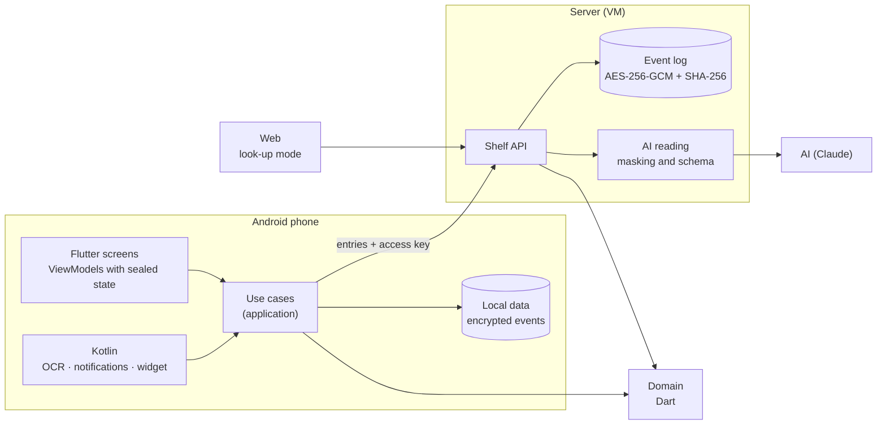
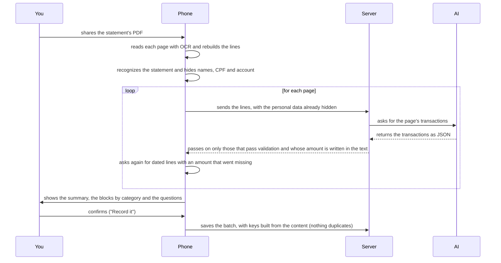

<div align="center">

<sub>[Português](README.md) · **English**</sub>


# Cajui

**Manage your finances by chatting with the app.**

An Android personal-finance app with an AI assistant: you chat to record expenses, and the app reads statements and
receipts and answers with the month's numbers. It is a complete project built from scratch: specification, a Dart
domain, a Flutter app, a cloud server of my own and a design system with a published gallery.

<picture>
  <source media="(prefers-reduced-motion: reduce)" srcset="docs/media/extrato-pela-juju.png" />
  
</picture>

<sub>Recorded from the real app, running with made-up data. No number is real.</sub>


**[See the design system gallery live](https://cajui-teal.vercel.app/gallery/)**

[About](#about-the-project) · [Architecture](#architecture) · [API documentation](docs/api.md) ·
[Decisions (32 ADRs)](docs/architecture/adr) · [Specification](docs/spec) · [Design system](packages/design_system) ·
[Security](docs/security) · [Wireframes](docs/design/wireframes.html)

<sub>The specification, the ADRs and the app itself are in Brazilian Portuguese.</sub>

</div>

---

**If you want to get to know the project:** [About the project](#about-the-project) · [Visuals](#visuals) · [Architecture](#architecture) ·
[Challenges I solved](#challenges-i-solved) · [Stack](#stack) · [Patterns applied](#design-patterns-applied) ·
[Security and privacy](#security-and-privacy) · [Quality](#quality) · [What went wrong](#what-went-wrong)<br />
**If you want to run it:** [Getting started](#getting-started) · [Scripts](#scripts) · [Structure](#project-structure) ·
[Publishing](#publishing) · [Roadmap](#roadmap)

## About the project

Cajui is an Android personal-finance app that I started to keep track of my household's bills, in place of a
spreadsheet that took work to maintain. The first version was the spreadsheet in app form, and I found filling everything in tiring. So I changed the focus: instead of screens to fill in, you chat with an assistant (Juju),
and the app uses what the bank already sends, such as notifications, statements and receipts. Today two phones share the
same data, synced, and there is a web page just for looking things up.

Besides being a personal tool, the project became my lab for learning and practicing software engineering for real:
MVVM, DDD (the business language and rules inside the domain), SOLID principles, clean architecture, dependency
injection and design patterns such as Factory, Strategy, Adapter, Repository, Observer and Singleton (here, the single
instances are handled by Riverpod's providers). The [patterns table](#design-patterns-applied) shows where each one
appears in the code, and the decisions are recorded in [ADRs](docs/architecture/adr).

**How it was built:** I wrote the specifications for what the app should do and built the project with Claude's help, as
a programming assistant. The Claude API is also used inside the app, in the conversation with Juju.

### What it does

- **Entries by conversation.** You type or speak "spent 35 at the market", and the app creates the entry with a
  category and a payment method. You can undo it right after.
- **Questions about the month.** The assistant answers how much is left, what is due and how much is missing to close
  the month, using the app's own numbers.
- **Statement reading.** You share the statement's PDF or screenshot; the phone reads it page by page, and the
  conversation checks it in blocks before saving. Reading the same statement twice does not duplicate entries.
- **Bank notifications.** An approved purchase becomes an entry automatically, with an option to undo. When money comes
  in, the app asks you to confirm.
- **Receipts.** A photo, screenshot or PDF becomes an entry proposal for you to check. The text recognition happens on
  the device, and only text with personal data masked goes to the AI.
- **Two phones, the same data.** Entries sync between the devices, and the web look-up is protected by an authenticator
  code.
- **Explicit money rules.** A credit card is a way to pay, not an expense. A meal voucher is a separate currency that is
  not added to cash. Both rules live in the domain's types.

### Technical overview

| Area            | What was done                                                                                                  | Where to look |
| --------------- | -------------------------------------------------------------------------------------------------------------- | ------------- |
| Architecture    | Clean architecture by feature, MVVM with sealed state (Riverpod), Coordinator and centralized dependency injection; a custom checker verifies the layers | [ADR-001](docs/architecture/adr/ADR-001-monorepo-e-dominio-compartilhado.md), [002](docs/architecture/adr/ADR-002-estado-com-riverpod.md), [031](docs/architecture/adr/ADR-031-navegacao-com-coordinator.md) |
| Domain          | Pure Dart shared by app and server; sealed `Result` and `Failure`; money as integer cents; numbered business rules, each with a test | [`packages/domain`](packages/domain) |
| AI              | Claude (Messages API, with *tool use*) behind a swappable interface; personal data masked before it leaves; every value the AI writes is checked | [ADR-010](docs/architecture/adr/ADR-010-integracao-com-a-deepseek.md), [021](docs/architecture/adr/ADR-021-assistente-que-age.md), [030](docs/architecture/adr/ADR-030-extrato-pela-juju.md) |
| Server          | Dart + Shelf, single executable, on Oracle Cloud (OCI), with TLS; encrypted, hash-chained event log; documented API | [`server/`](server), [`docs/api.md`](docs/api.md) |
| Design system   | Own package with tokens, components, 3D motion and sounds; a published gallery with the screen states | [`packages/design_system`](packages/design_system), [gallery](https://cajui-teal.vercel.app/gallery/) |
| Native Android  | Share intake, on-device OCR, bank notifications, home screen widget, reminders and voice input | [`app/android`](app/android) |
| Quality         | 1,850 tests, named after the rule they prove; 86% to 93% coverage per package; secret scan over the history | [`tool/`](tool), [quality-gates](docs/spec/quality-gates.md) |
| Process         | 32 ADRs, Conventional Commits, pull requests and CI on GitHub Actions | [`docs/architecture`](docs/architecture) |

### Decisions that guided the project

Two decisions shaped the rest. The first: the AI only reads and suggests; the domain does the math and applies the
rules, in Dart, used by both the app and the server. The second: in the statement conversation, Juju's sentences
are built by the app from the domain's numbers, not by the model, so what she says matches what the screen shows.

### How to make use of this project

- **Run the app.** Clone the repository, run `flutter pub get` and `flutter run`. With no server configured, it works on
  its own on the device (see [Getting started](#getting-started)).
- **Connect it to a server of your own.** The server in [`server/`](server) runs on your machine with
  `scripts/servidor-local.ps1`; the app points to it through the `CAJUI_API_URL` and `CAJUI_ACCESS_KEY` variables. The
  AI key stays outside the repository.
- **Reuse the design system.** The [`packages/design_system`](packages/design_system) package depends on neither the app
  nor Riverpod, and the [gallery](https://cajui-teal.vercel.app/gallery/) shows every component in every state.
- **Reuse the domain.** The [`packages/domain`](packages/domain) package is plain Dart, with no Flutter (money, installments, card
  statements, the month's budget) and fits another app or server.
- **Study the decisions.** The [ADRs](docs/architecture/adr) explain the reason behind each choice, and the
  [API documentation](docs/api.md) describes every server route.

## Visuals

<p align="center">
  
  <br /><sub>The statement with Juju: summary, blocks by category, one question at a time and the whole batch with "Undo all".</sub>
</p>

<p align="center">
  
  <br /><sub>Home with the 3D carousel, My month with cash and voucher always apart, and the card wallet.</sub>
</p>

<p align="center">
  
  <br /><sub>The design system gallery: every component, state and screen of the app, browsable, with sound and a dark
  theme · <a href="https://cajui-teal.vercel.app/gallery/">see it live</a> · <a href="packages/design_system">its README</a></sub>
</p>

<p align="center">
  
  <br /><sub>The glass widget and the arrival in the app, recorded in the gallery with made-up numbers.</sub>
</p>

## Architecture

Clean architecture, organized by feature (`features/<x>/{application,infrastructure,presentation}`).
`composition.dart` is the only place that binds a port to an adapter, and no math lives in the app: it asks the domain.



**How a statement becomes entries**, from the moment you share it to the moment it is saved:



More in the [ADRs](docs/architecture/adr): [030](docs/architecture/adr/ADR-030-extrato-pela-juju.md) covers the
statement, [020](docs/architecture/adr/ADR-020-chave-da-casa.md) access, and
[022](docs/architecture/adr/ADR-022-a-ia-le-a-foto.md) the photo read by the AI.

### The app

The app is Flutter, in clean architecture organized by feature: each one has `application` (use cases),
`infrastructure` (adapters) and `presentation` (screens and ViewModels).

- **MVVM with sealed state.** The screen only draws; the ViewModel is a Riverpod `Notifier`, and the state is a sealed
  hierarchy, so an exhaustive `switch` makes a new state without a design fail to compile.
- **Navigation by Coordinator.** Each feature has a coordinator over the `SceneNavigator` port: the screen says what the
  person tapped, and the coordinator decides which scene to open. A ViewModel never navigates.
- **Centralized dependency injection.** Every dependency (repositories, services, adapters) is registered in one file,
  `composition.dart`. An automatic checker stops an inner layer from importing an outer one. Business rules do not live
  in the app: it asks the domain.
- **Offline first.** The data lives on the device, encrypted, as an event history (each entry is an event), and syncs when there is network.
- **Look and feel only through the design system.** Colors, typography, spacing and animation durations come from the
  design system package, never from the screens' code. The app uses `WidgetsApp` instead of `MaterialApp` so it does
  not inherit Material's look, and an automatic check blocks any color or style defined directly in a screen.

### The server

A single Dart (Shelf) executable running on a VM on **Oracle Cloud Infrastructure (OCI)**, on the free tier, behind a
proxy with automatic TLS and managed as a system service. What it does:

- **Stores the data as an event log.** Each event is encrypted with AES-256-GCM and chained by SHA-256, so any change
  to the past is detected. There are per-file summaries and a daily encrypted backup, copied off the machine.
- **Validates everything that arrives.** JSON is read strictly (an extra, missing or wrong-type field is refused), the
  domain rules are checked again on the server, and every error carries a code from a catalog of 47.
- **Authenticates.** The device signs in with an access key, a random secret shared by the phones of the same household (called the "house key" in the project); the server keeps only the hash and compares in constant
  time). The web look-up signs in with an authenticator code (TOTP, RFC 6238), which opens a 30-day read-only session,
  locked after five wrong attempts.
- **Protects.** Per-origin rate limiting, CORS for a single origin, and secrets in the service's encrypted credentials,
  never in the repository.
- **Talks to the AI** (next section) and returns only what passes the schema.

Every route is documented, with request, response and errors, in [`docs/api.md`](docs/api.md).

### The AI

Juju is a conversational assistant with ***tool use***: the server integrates Anthropic's Messages API (Claude) and
gives the model real tools: record an expense, cancel, list, record income, recategorize and pay down a debt. The
decisions worth telling:

- **The AI reads, the domain decides.** The model returns structured data; the domain does the math and applies the
  rules.
- **One port, several vendors.** The server only knows the `ChatClient` interface (Strategy pattern). There are adapters
  for Claude and for DeepSeek, chosen by configuration, and a fake client in the tests.
- **Privacy before the AI.** Person names, CPF numbers and accounts are masked on the phone, before the text leaves it.
- **The AI's answer is untrusted input.** Every amount in reais it writes is checked against the summary the server
  sent, the tools and the question (RN-943). A value with no source goes back to the model once; if it insists, a
  fixed-format answer is returned.
- **Limits.** A monthly token budget, a circuit breaker and a per-call timeout; if the AI is down, the app says so and
  keeps recording by hand.

### Sync between devices

The data is a history of facts (entries, corrections and cancellations), each with an idempotency key: resending the same request never records it again. The
server only stores and returns; each phone does the math, with the same domain. The app checks the top of the log every
20 seconds and downloads the data only when something changed. A card or category edited on two devices is resolved by the
newest version, and a cancelled entry never comes back to life.

### The design system

The design system is an own Dart package, [`packages/design_system`](packages/design_system), and the app is its first
consumer:

- **Tokens by role**: color, type, spacing, radius, shadow, duration, curve and sound come from the package by role name.
  Changing the color of every action button means editing one line, and the contrast test runs right after.
- **Components** in every state: buttons, amounts, cards, fields, notices, chat, the month's rings and timeline, a 3D
  credit card, glass, carousel and card stack.
- **Motion and sound**: depth scrolling, a cinematic entrance and one sound per control family, with three motion levels
  and respect for "reduce motion".
- **Accessibility**: computed contrast, 48 dp touch targets, enlarged system fonts and screen readers.
- **The gallery** ([live](https://cajui-teal.vercel.app/gallery/)) is the sample app: it shows every component, every app screen in its states and every
  design decision, with dark theme, sound and motion adjustable.

### The native side (Android)

The Kotlin modules cover what Flutter doesn't reach: receiving image, PDF and text shares; on-device OCR with ML Kit
(the PDF is rasterized by Android itself); reading the banks' notifications; the glass home screen widget; due-date
reminders; voice input (speaking instead of typing); and the device key kept in the Keystore.

## Challenges I solved

### 1. A whole statement in one conversation, without recording anything twice

- **Problem:** a monthly statement has dozens of lines, and the old reading stopped at 30. Reading it again, sharing
  it twice, or undoing and recording again could not duplicate anything.
- **Solution:** the phone reads page by page (`POST /v1/statements/read-part`), and the AI only reads. The
  conversation is built by the app ([`StatementDigest`](packages/domain/lib/src/statements/statement_digest.dart),
  [`StatementWords`](packages/domain/lib/src/statements/statement_words.dart)). Each saved line carries a key made
  from its content, not its position ([`StatementLineKey`](packages/domain/lib/src/statements/statement_line_key.dart)),
  plus the stamp of that batch. "Already in Cajui" is a one-to-one match by amount, day and name
  ([`StatementMatches`](app/lib/src/features/statements/application/statement_matches.dart)).
- **Result:** reading the same statement again shows "already in Cajui"; two identical purchases at the same bakery
  stay two; and "Undo all" followed by "Record" saves again, with ids that were never undone.

### 2. The table the OCR takes apart

- **Problem:** in the first test on the device, the line "Restaurante Sabor" came with the supermarket's amount. ML
  Kit returns text by blocks, and on a table-shaped page each column becomes a block. On top of that, the OCR sometimes
  breaks a number ("+3.120,,00", "-32, 80"), and the server dropped the line without a word.
- **Solution:** the native side rebuilds each page into rows by the height of each piece
  ([`TextRows.kt`](app/android/app/src/main/kotlin/app/cajui/capture/TextRows.kt)); the domain repairs numbers the OCR
  broke ([`OcrLine`](packages/domain/lib/src/statements/ocr_line.dart)); and the phone checks the AI's answer: a line
  with a date and an amount that it did not cite is asked again, and whatever is still missing is said out loud
  ([`MissedLines`](app/lib/src/features/statements/application/missed_lines.dart)).
- **Result:** no line disappears silently. The device cases became tests with the exact lines the OCR read.

### 3. A card is a way to pay; a voucher is another currency

- **Problem:** the spreadsheet knew that a card purchase counts in the month it was made, not in the month of the
  bill, and that a meal voucher is not money. An app that adds everything into one total gets the whole month wrong.
- **Solution:** every monthly amount is a `TenderAmounts`, with cash and voucher in separate fields, and no operation
  joins them. The card bill is a computed view, never an entry; an installment purchase becomes a commitment in the
  debts block, one installment at a time.
- **Result:** the compiler rejects the wrong sum. A bill payment read from a statement shows up as "doesn't count".

### 4. Privacy before the AI

- **Problem:** statements and receipts carry the name of whoever got the Pix, tax IDs and account numbers.
- **Solution:** masking runs on the phone before anything is sent
  ([`PiiRedactor`](packages/domain/lib/src/receipts/pii_redactor.dart),
  [`TransferLine`](packages/domain/lib/src/statements/transfer_line.dart)). The real name stays on the device and only
  shows up there, in the question ("Pix para Carla M Souza"). The AI's answer goes through a closed schema, and every
  amount must be written in the text. A remembered answer about a person never becomes an example for the AI.
- **Result:** the AI sees "PIX ENVIADO [NOME] 150,00" and the phone shows the name. A suite of malicious receipts tries
  prompt injection.

<details>
<summary><b>5 more challenges: sync, a custom checker, screen transitions, sound and the glass widget</b></summary>

### 5. Two phones, the same data

- **Problem:** the couple uses two phones, and each one sometimes records without a connection.
- **Solution:** an event log (nothing is deleted; fixing and cancelling append), ids born from content, and "the
  newest edit wins" ([ADR-019](docs/architecture/adr/ADR-019-dois-aparelhos-um-livro.md)). With the app in front, each
  phone asks the server, every 20 seconds, for a number that only moves when the data changes
  ([ADR-024](docs/architecture/adr/ADR-024-sincronia-ao-vivo-e-auth-simples.md)).
- **Result:** what one records shows up on the other within seconds, and downloading the data again never duplicates.

### 6. Code rules that a machine enforces

- **Problem:** clean architecture held only by convention falls apart at the first tight deadline.
- **Solution:** a custom checker built on `package:analyzer` ([`tool/code_metrics`](tool/code_metrics)) runs on
  pre-commit and in the pipeline. It rejects imports that point outward across layers, files over 300 lines, functions
  over 30, more than 3 levels of nesting, two public types in one file, and colors written by hand on a screen.
- **Result:** 1,166 files checked on every commit, no limit broken. Changing the color of every button is one token.

### 7. The screen transition that mixed two screens

- **Problem:** when a screen opened, the previous one still showed under the new one for a few frames.
- **Solution:** the camera move between screens became a hand-over on one shared linear clock
  ([`CameraMove`](packages/design_system/lib/src/motion/camera_move.dart)): the screen behind leaves entirely before
  the new one arrives.
- **Result:** checked on the device with a screen recording, frame by frame, and pinned by a test that fails with the
  old code.

### 8. One sound per control family

- **Problem:** the chosen sounds came as MP3, with leading silence and different loudness. On the phone, even at full
  volume, they almost vanished: a phone speaker barely plays below 300–400 Hz, and the button click had 99% of its
  energy between 150 and 300 Hz.
- **Solution:** leading silence cut, a 2 ms fade-in and a cosine fade-out; then a custom mastering tool
  ([`level_sounds.py`](tool/sound/level_sounds.py)) creates harmonics from the lows (the ear rebuilds the note), cuts
  the sub-bass and gently saturates each family up to its target, measured the way the phone plays it (ITU-R BS.1770
  K-weighting). The origin and license of each file are in [`CREDITS.md`](packages/design_system/assets/CREDITS.md).
- **Result:** action buttons, cards, keys, switches and chips each have their own sound, as a design system token, and
  a test fails any sound that drops back below what the speaker can play.

### 9. A glass widget that Android won't let you blur

- **Problem:** the home screen widget should look like glass, but an Android widget is drawn by another process
  (`RemoteViews`): no wallpaper blur, no shader, no animation of its own.
- **Solution:** the aurora is only diffuse light, in layers of radial gradients, and the glass is a translucent veil
  with a rim of light: it looks frosted because what is behind it has no edges anymore. The widget's root is marked as
  `@android:id/background`, so Android 12+ opens the app growing out of it. In the app, the `widget` route plays the
  arrival ([`CajuiGlassArrival`](packages/design_system/lib/src/motion/cajui_glass_arrival.dart)): the Home numbers
  come through the glass, with the aurora lit behind them.
- **Result:** the same composition exists as design system components (`CajuiAurora`, `CajuiGlassPanel`, `CajuiOrb`),
  and the gallery shows the whole gesture, from the tap on the widget to the arrival.

</details>

## Stack

| Layer             | Technologies                                                                                    |
| ----------------- | ----------------------------------------------------------------------------------------------- |
| App               | Flutter 3.47 (Android to use, web to look things up), Riverpod 3 with sealed state, Dart 3.13   |
| Native (Android)  | Kotlin: share intake, on-device OCR with ML Kit, notification reading, widget, reminders        |
| Domain            | Pure Dart, no Flutter and no `dart:io`: the same code on the phone and on the server            |
| Server            | Dart + Shelf, compiled to a single executable, on an Oracle Cloud (OCI) VM, with a TLS proxy and a system service     |
| Data              | Event log encrypted with AES-256-GCM and chained with SHA-256, daily backup                     |
| AI                | Claude (Messages API, with tools) or DeepSeek, behind the same `ChatClient` port                         |
| Design system     | Own package with tokens, components, glass, 3D motion and sounds; gallery published on Vercel   |
| Quality           | `very_good_analysis`, custom checker, per-package coverage floors, secret scanning              |
| Pipeline          | GitHub Actions, Conventional Commits, Vercel for the web                                        |

## Design patterns applied

Cajui is also my coursework for Mobile Development II, which asks for the app and the design system to follow the
patterns studied during the semester. The rule I followed was **one pattern per question**, never two for the same
thing.

| Question      | Pattern chosen                                                                     | Where                                                                                                                                                                                           |
| ------------- | ---------------------------------------------------------------------------------- | ----------------------------------------------------------------------------------------------------------------------------------------------------------------------------------------------- |
| One screen    | MVVM: the page only draws, a Riverpod `Notifier` decides, the state is sealed      | [`entries_view_model.dart`](app/lib/src/features/ledger/presentation/entries_view_model.dart)                                                                                                   |
| The whole app | Layers (Clean), locked by a checker                                                | [`layer_rules.dart`](tool/code_metrics/lib/src/layer_rules.dart) · [ADR-001](docs/architecture/adr/ADR-001-monorepo-e-dominio-compartilhado.md)                                                 |
| Navigation    | Coordinator: the ViewModel says what happened, the Coordinator decides where to go | [`core/navigation`](app/lib/src/core/navigation) · [ADR-031](docs/architecture/adr/ADR-031-navegacao-com-coordinator.md)                                                                        |
| Dependencies  | Injection with Riverpod, wired in a single composition root                        | [`composition.dart`](app/lib/src/app/composition.dart) · [ADR-002](docs/architecture/adr/ADR-002-estado-com-riverpod.md), [ADR-032](docs/architecture/adr/ADR-032-injecao-e-factory-de-cena.md) |
| Folders       | By feature: `features/<x>/{application,infrastructure,presentation}`               | one folder per scene                                                                                                                                                                            |
| Repository    | Monorepo of packages                                                               | [`packages/`](packages) · [ADR-001](docs/architecture/adr/ADR-001-monorepo-e-dominio-compartilhado.md)                                                                                          |

<details>
<summary><b>The class pieces and where they live in Cajui</b></summary>

| Class piece                           | In Cajui                                                                                                                                                                                                                                                                                                                          |
| ------------------------------------- | --------------------------------------------------------------------------------------------------------------------------------------------------------------------------------------------------------------------------------------------------------------------------------------------------------------------------------- |
| Core (models, repositories, `Result`) | [`packages/domain`](packages/domain) and [`packages/api_contract`](packages/api_contract)                                                                                                                                                                                                                                         |
| Design System                         | [`packages/design_system`](packages/design_system)                                                                                                                                                                                                                                                                                |
| Scene                                 | One folder per feature, with `application`, `infrastructure` and `presentation`                                                                                                                                                                                                                                                   |
| Scene factory                         | The Coordinator builds the page and the ViewModel's provider delivers the dependencies ([ADR-032](docs/architecture/adr/ADR-032-injecao-e-factory-de-cena.md))                                                                                                                                                                    |
| Coordinator                           | One per feature, in `presentation`, over the [`SceneNavigator`](app/lib/src/core/navigation/scene_navigator.dart) port: [`LedgerCoordinator`](app/lib/src/features/ledger/presentation/ledger_coordinator.dart), `BudgetCoordinator`, `CardsCoordinator`… ([ADR-031](docs/architecture/adr/ADR-031-navegacao-com-coordinator.md)) |
| View                                  | `*_page.dart`, only draws, with design system components                                                                                                                                                                                                                                                                          |
| ViewModel                             | `*_view_model.dart` (a `Notifier`), with the sealed state next to it                                                                                                                                                                                                                                                              |
| Server                                | The feature's port (`AssistantGateway`, `LedgerDownlink`…) and the HTTP adapter in `infrastructure`                                                                                                                                                                                                                               |
| Storage                               | `PreferencesStore`, `HouseholdKeyStore` and the event log, each with a real and an in-memory version                                                                                                                                                                                                                           |

</details>

<details>
<summary><b>Design patterns: where each one appears</b></summary>

| Pattern    | Where it appears                                                                                                                                                                                                                                                    |
| ---------- | ------------------------------------------------------------------------------------------------------------------------------------------------------------------------------------------------------------------------------------------------------------------- |
| Factory    | `factory of(...)` in [`home_view.dart`](app/lib/src/features/home/application/home_view.dart) and [`statement_view.dart`](app/lib/src/features/cards/application/statement_view.dart)                                                                               |
| Adapter    | [`NativeReceiptReader`](app/lib/src/features/receipts/infrastructure/native_receipt_reader.dart) fits Android's OCR into the `ReceiptReader` port; [`HttpAssistantGateway`](app/lib/src/features/assistant/infrastructure/http_assistant_gateway.dart) fits the API |
| Strategy   | [`ChatClient`](server/lib/src/ai/chat_client.dart) with [`DeepSeekChatClient`](server/lib/src/ai/deepseek_chat_client.dart) and [`ClaudeChatClient`](server/lib/src/ai/claude_chat_client.dart), chosen when the server starts                                      |
| Observer   | Riverpod's `ref.watch` in the pages and `Stream` in the live sync                                                                                                                                                                                                   |
| Repository | [`LedgerJournal`](app/lib/src/features/ledger/application/ledger_journal.dart), with local, remote and in-memory versions                                                                                                                                           |
| Result     | [Sealed `Result` and `Failure`](packages/domain/lib/src/shared/result.dart): a refused rule is a value, not an exception; [`Decoded`](packages/api_contract/lib/src/decoded.dart) does the same for a request that comes from outside                               |

</details>

**Class deliverables:**

| Deliverable                         | Where                                                                                                                                      |
| ----------------------------------- | ------------------------------------------------------------------------------------------------------------------------------------------ |
| App theme                           | [Problem and audience](docs/spec/problem.md) and [brand](docs/brand)                                                                       |
| Screen prototype                    | [Low-fidelity wireframes](docs/design/wireframes.html): navigation map, 14 screens and the states                                          |
| Components and design system sample | [`packages/design_system`](packages/design_system) and the [live gallery](https://cajui-teal.vercel.app/gallery/), which is the sample app |
| API documentation                   | [`docs/api.md`](docs/api.md): every route with request, response and errors                                                                |

## Security and privacy

- **An access key** of 32 random bytes, generated on the installer's computer and compiled into the APK. The server
  keeps only its hash, in an encrypted systemd credential ([ADR-020](docs/architecture/adr/ADR-020-chave-da-casa.md)).
- **The web signs in with an authenticator code** (TOTP, RFC 6238), and that secret is also encrypted on the VM
  ([ADR-027](docs/architecture/adr/ADR-027-codigo-do-autenticador.md)).
- **The AI key exists only on the server**, never in the app, the web bundle or the repository. A scanner checks the
  tree **and the whole history** on every commit and every PR.
- **Data encrypted at rest:** each record with AES-256-GCM, chained with SHA-256. It is possible to prove nobody
  touched the past.
- **Masking before the AI, and the AI's answer treated as hostile input**, as in [challenge 4](#4-privacy-before-the-ai).
- A STRIDE threat model and an ASVS level 2 checklist live in [`docs/security`](docs/security). Where a control is
  **not** implemented, it says so.

## Quality

| Item              | Status                                                                                                    |
| ----------------- | --------------------------------------------------------------------------------------------------------- |
| Tests             | **1,850**: app 611 · domain 493 · server 253 · design system 257 · contract 104 · gallery 81 · persistence 25 · checker 26 |
| Coverage          | contract 93.2% · domain 92.9% · persistence 91.5% · server 89.9% · design system 88.0% · app 86.4%       |
| Rule ↔ test       | Every rule has a number (`RN-xxx`) and a test with the same number. A numeric example in the spec becomes a test, to the cent |
| Texts             | Every error a person reads comes from a catalog of 47 codes, and the code that shows it is **generated** from it. A test per code makes sure no text goes out with an unfilled placeholder |
| Voice             | Banned terms ("déficit", "estourou", exclamation marks) are rejected by a test across every sentence in the app |
| Analyzer          | `very_good_analysis`, zero warnings                                                                       |
| Custom checker    | 1,166 files, no limit broken                                                                                |
| Accessibility     | Lighthouse 100 on the web; semantics on from the root; the screen reader says who is speaking in the chat |

**By the numbers:** 108 thousand lines of Dart in 1,168 files (40 thousand of them tests), 2.9 thousand of Kotlin, 134 non-functional requirements, 32 ADRs and 159 pull requests.

## What went wrong

Problems that showed up along the way, and how each one was solved:

- **Green tests missed what the device caught.** The statement feature passed hundreds of tests, and the first real
  PDF mixed up columns ([challenge 2](#2-the-table-the-ocr-takes-apart)). Before that, the app read the API's error
  body in the wrong place, and the test missed it because the fake server mimicked the client's assumption, not the
  server.
- **An installment purchase counted in full in the month it was made.** The domain always knew how to do it right;
  the layer above added things up on its own instead of asking. It was the core concept of the product, broken.
- **Three error texts came out broken.** A test that walks through every error code the statement reading can bring
  found three unfilled placeholders.
- **The web had never run.** The `dart:io` HTTP client breaks when created in the browser, and the app died before its
  first frame, with no message.
- **An unreadable share closed the app on launch.** A hostile app sends exactly that on purpose.

Each one was found by an adversarial review or by real use, and each one has a test that pins the case today.

## Cost

**R$ 0.00 fixed.** A free Oracle VM, Let's Encrypt TLS, free dynamic DNS, repository and pipeline on GitHub, and the
web on Vercel's Hobby plan. The only variable cost is the AI, billed per use: with DeepSeek it comes to **about R$ 0.60 a month** for 120
entries ([the math is here](docs/ops/ai-cost-estimate.md)); Claude costs more per token, and switching is only a
configuration change.

---

## For developers

### Getting started

**Requirements:** Flutter 3.47 (with Dart 3.13), the Android SDK and an Android device or emulator. Python 3 only for
the pipeline's checkers.

```bash
git clone https://github.com/Marcos-Codfy/finance-cajui.git
cd finance-cajui
flutter pub get
cd app && flutter run
```

Without the access key compiled in, the app starts with no server and works on its own on the device. The key
(`CAJUI_ACCESS_KEY`) and the server address (`CAJUI_API_URL`) come in through `--dart-define` and are never versioned. The look-up
web build comes from `flutter build web --no-web-resources-cdn` inside `app/`.

### Scripts

| Command (PowerShell, from the root)    | What it does                                                                 |
| -------------------------------------- | ---------------------------------------------------------------------------- |
| `.\scripts\apk.ps1 -Release`           | Builds the APK and installs it on the phone on USB (key and server by environment variable) |
| `.\scripts\servidor-local.ps1`         | Runs the server on this machine, reading the AI key from outside the repo    |
| `dart run tool/code_metrics/bin/check.dart` | Runs the size and layer checker                                         |

<details>
<summary><b>Tests for each package</b></summary>

```bash
cd app && flutter test
cd packages/design_system && flutter test
cd packages/design_system/gallery && flutter test
cd packages/domain && dart test
cd packages/api_contract && dart test
cd packages/persistence && dart test
cd server && dart test
cd tool/code_metrics && dart test
```

</details>

### Project structure

<details>
<summary><b>Folder tree</b></summary>

```text
app/                      Flutter: Android to use, web to look things up
  lib/src/features/       assistant, statements, receipts, ledger, budget, cards, home, export, reminders…
  android/                Kotlin: share intake, OCR, notifications, widget, reminders
packages/
  domain/                 business rules in Dart
  api_contract/           DTOs, strict JSON reading, error catalog
  persistence/            encrypted event log with a hash chain
  design_system/          tokens, components, motion, sounds
    gallery/              the browsable design system sample
server/                   Dart + Shelf: API, AI reading, sync
tool/                     checkers: size, layers, secrets, coverage
docs/                     specification, ADRs, brand, security, cost and performance
scripts/                  APK, local server and web build
```

</details>

### Publishing

- **Server:** a single Dart executable (`dart compile exe`), built in the pipeline and served behind a TLS proxy. The
  operation of the machine (provisioning, service, backup) is not part of this copy; the decisions are in ADRs
  [003](docs/architecture/adr/ADR-003-backend-dart-shelf.md),
  [005](docs/architecture/adr/ADR-005-criptografia-em-repouso-e-dbtool.md) and
  [011](docs/architecture/adr/ADR-011-hospedagem-a-custo-zero.md).
- **Web:** Vercel publishes `main`: the read-only web at the root and the design system gallery at `/gallery/`, both
  built by [`scripts/web.sh`](scripts/web.sh).
- **App:** the APK is built and installed over USB, with the access key and the server address compiled in.

## Roadmap

- [x] Specification, brand and design system approved
- [x] Domain with the card as a way to pay and the voucher as another currency
- [x] Receipts by photo, screenshot and PDF, with on-device OCR and AI when the rules are not enough
- [x] Bank notifications that become entries
- [x] Juju: record by talking, ask with the household's numbers, speak instead of typing
- [x] Two phones synced live and a look-up web with an authenticator
- [x] Statements with Juju, page by page, with a batch and "Undo all"
- [x] Due-date reminders, widget, monthly spreadsheet and 3D motion
- [ ] Check the reading against real statements from each bank
- [ ] Several files from the same share in a single reading
- [x] Publish the design system gallery ([live](https://cajui-teal.vercel.app/gallery/))
- [ ] Read the PDF's text layer, besides the OCR

## Credits

- **Specification, design and development:** [Marcos Vinicius Muniz Arruda](https://github.com/Marcos-Codfy)
- **Fonts:** Fraunces and Geist (SIL Open Font License)
- **Touch sounds:** Pixabay, under the Pixabay Content License, processed in the project; the others are synthesized
  here ([origin of each file](packages/design_system/assets/CREDITS.md))
- **Icons and illustrations:** drawn in the project

## License

[MIT](LICENSE). Fonts and sounds have their own licenses, listed in the credits above.

---

<div align="center">

<sub>The name comes from the **cajuí** (<i>Anacardium humile</i>), the low-growing wild cashew of the Tocantins
Cerrado.</sub>

<sub>Made by <a href="https://github.com/Marcos-Codfy">Marcos Vinicius Muniz Arruda</a> · Palmas, Brazil · 2026</sub>

</div>
