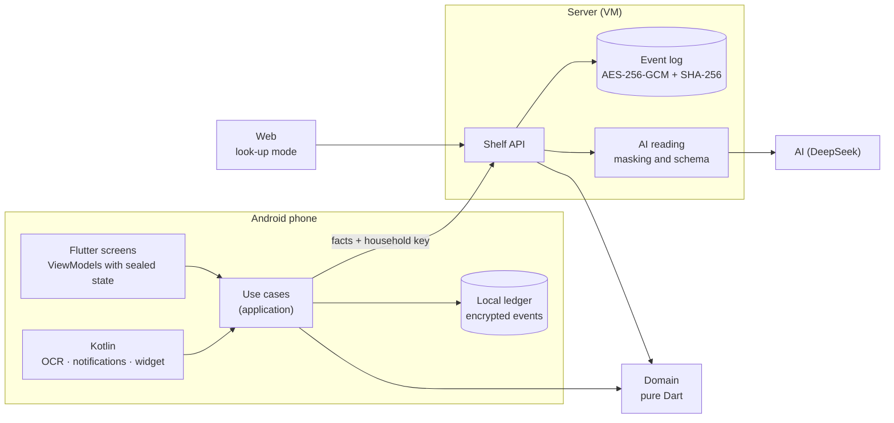
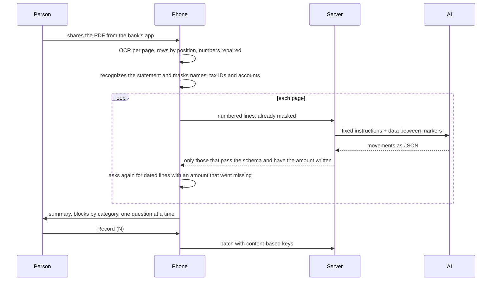

<div align="center">

<sub>[Português](README.md) · **English**</sub>


# Cajui

**A household's money, in one conversation.**

A personal finance app for Android, with an assistant that records what you say, reads the bank statement you share
from your bank's app and asks only about what it doesn't know. Built from scratch: specification, pure Dart domain,
Flutter app, own server, design system and a quality pipeline. Fixed cost: **R$ 0.00 a month**.

<picture>
  <source media="(prefers-reduced-motion: reduce)" srcset="docs/media/extrato-pela-juju.png" />
  
</picture>

<sub>Recorded from the real app, running with a made-up household. No number belongs to anyone.</sub>


[Specification](docs/spec) · [Decisions (30 ADRs)](docs/architecture/adr) · [Design system](packages/design_system) ·
[Security](docs/security) · [Operations](docs/ops/runbook.md) · [Progress](PROGRESS.md)

<sub>The specification, the ADRs and the app itself are in Brazilian Portuguese.</sub>

</div>

---

**For reviewers:** [In 30 seconds](#in-30-seconds) · [Visuals](#visuals) · [Behind the scenes](#behind-the-scenes) ·
[Challenges I solved](#challenges-i-solved) · [Stack](#stack) · [Architecture](#architecture) ·
[Security and privacy](#security-and-privacy) · [Quality](#quality) · [What went wrong](#what-went-wrong)<br />
**For developers:** [Getting started](#getting-started) · [Scripts](#scripts) · [Structure](#project-structure) ·
[Deploy](#deploy) · [Roadmap](#roadmap)

## In 30 seconds

- **My role:** a personal project, from scratch and on my own. I wrote the specification (420 numbered business
  rules), the domain, the app, the native Kotlin side, the server, the design system and brand, the infrastructure
  and the pipeline.
- **What it is:** the app that replaced my household's finance spreadsheet. Two Android phones share the same ledger,
  synced live, and a web page is there for looking things up.
- **What sets it apart:**
  - **Juju** records the expense you tell her ("gastei 35 no mercado", "I spent 35 at the market") and answers with
    your own numbers;
  - she **reads the statement** you share from your bank's app, page by page, and checks it with you block by block
    before anything is saved;
  - a **bank notification** for an approved purchase becomes an entry on its own, with "Undo"; money coming in asks
    for a tap. A **receipt** (photo, screenshot or PDF) becomes a proposal ready to confirm.
- **The two concepts almost every finance app gets wrong:** a credit card is a way to pay, never an expense; and a
  meal voucher is another currency that is never added to cash. Both are enforced by the domain's types, not by
  discipline.
- **Privacy:** what goes to the AI leaves the phone with people's names, tax IDs and account numbers masked. The AI's
  answer is treated as untrusted input: every amount it returns must be written in the document.
- **Engineering:** clean architecture with the layers locked by a custom checker, 1,584 tests named after the rule
  they prove, 85% to 95% coverage per package, 30 ADRs and a GitHub Actions pipeline.

## Visuals

<p align="center">
  
  <br /><sub>The statement with Juju: summary, blocks by category, one question at a time and the whole batch with "Undo all".</sub>
</p>

<p align="center">
  
  <br /><sub>Home with the 3D carousel, My month with cash and voucher always apart, and the card wallet.</sub>
</p>

<p align="center">
  
  <br /><sub>The design system gallery: every component, state and screen of the app, browsable, with sound and a dark theme.</sub>
</p>

## Behind the scenes

Cajui started as a replacement for a spreadsheet that worked, but only because someone fed it by hand. The first
version followed the spreadsheet to the letter, and the verdict from the people using it was blunt: "it got boring to
use". That turned the project around: fewer screens, an assistant that talks and records, and the phone doing work on
its own (a bank notification becomes an entry; a shared receipt becomes a one-tap proposal).

AI helps where it helps, and never decides. The math lives in the domain, in pure Dart, and the same code runs on the
phone and on the server. The AI reads text and photos and returns structured data that the domain checks. In the
statement conversation, none of Juju's sentences goes through the model: the app builds each one from the domain's
numbers, so what she says is always what the screen shows.

My favorite detail is testing on a real phone. The statement feature passed hundreds of tests, and the first PDF
shared on the device showed a restaurant with the supermarket's amount. It was the OCR returning the table by columns
([challenge 2](#2-the-table-the-ocr-takes-apart)). Since then, every new screen is checked in the browser and on the
device before a step is closed.

## Challenges I solved

### 1. A whole statement in one conversation, without recording anything twice

- **Problem:** a monthly statement has dozens of lines, and the old reading stopped at 30. Reading it again, sharing
  it twice, or undoing and recording again could not duplicate anything.
- **Solution:** the phone reads page by page (`POST /v1/statements/read-part`), and the AI only reads. The
  conversation is built by the app ([`StatementDigest`](packages/domain/lib/src/statements/statement_digest.dart),
  [`StatementWords`](packages/domain/lib/src/statements/statement_words.dart)). Each saved line carries a key made
  from its content, not its position ([`StatementLineKey`](packages/domain/lib/src/statements/statement_line_key.dart)),
  plus the stamp of that batch. "Already in Cajui" is a one-to-one match by amount, day and name
  ([`StatementMatches`](app/lib/src/features/statements/application/statement_matches.dart)).
- **Result:** reading the same statement again shows "already in Cajui"; two identical purchases at the same bakery
  stay two; and "Undo all" followed by "Record" saves again, with ids that were never undone.

### 2. The table the OCR takes apart

- **Problem:** in the first test on the device, the line "Restaurante Sabor" came with the supermarket's amount. ML
  Kit returns text by blocks, and on a table-shaped page each column becomes a block. On top of that, the OCR sometimes
  breaks a number ("+3.120,,00", "-32, 80"), and the server dropped the line without a word.
- **Solution:** the native side rebuilds each page into rows by the height of each piece
  ([`TextRows.kt`](app/android/app/src/main/kotlin/app/cajui/capture/TextRows.kt)); the domain repairs numbers the OCR
  broke ([`OcrLine`](packages/domain/lib/src/statements/ocr_line.dart)); and the phone checks the AI's answer: a line
  with a date and an amount that it did not cite is asked again, and whatever is still missing is said out loud
  ([`MissedLines`](app/lib/src/features/statements/application/missed_lines.dart)).
- **Result:** no line disappears silently. The device cases became tests with the exact lines the OCR read.

### 3. A card is a way to pay; a voucher is another currency

- **Problem:** the spreadsheet knew that a card purchase counts in the month it was made, not in the month of the
  bill, and that a meal voucher is not money. An app that adds everything into one total gets the whole month wrong.
- **Solution:** every monthly amount is a `TenderAmounts`, with cash and voucher in separate fields, and no operation
  joins them. The card bill is a computed view, never an entry; an installment purchase becomes a commitment in the
  debts block, one installment at a time.
- **Result:** the compiler rejects the wrong sum. A bill payment read from a statement shows up as "doesn't count".

### 4. Privacy before the AI

- **Problem:** statements and receipts carry the name of whoever got the Pix, tax IDs and account numbers.
- **Solution:** masking runs on the phone before anything is sent
  ([`PiiRedactor`](packages/domain/lib/src/receipts/pii_redactor.dart),
  [`TransferLine`](packages/domain/lib/src/statements/transfer_line.dart)). The real name stays on the device and only
  shows up there, in the question ("Pix para Carla M Souza"). The AI's answer goes through a closed schema, and every
  amount must be written in the text. A remembered answer about a person never becomes an example for the AI.
- **Result:** the AI sees "PIX ENVIADO [NOME] 150,00" and the phone shows the name. A suite of malicious receipts tries
  prompt injection.

<details>
<summary><b>4 more challenges: sync, a custom checker, screen transitions and sound</b></summary>

### 5. Two phones, one ledger

- **Problem:** the couple uses two phones, and each one sometimes records without a connection.
- **Solution:** an event log (nothing is deleted; fixing and cancelling append), ids born from content, and "the
  newest edit wins" ([ADR-019](docs/architecture/adr/ADR-019-dois-aparelhos-um-livro.md)). With the app in front, each
  phone asks the server, every 20 seconds, for a number that only moves when the ledger changes
  ([ADR-024](docs/architecture/adr/ADR-024-sincronia-ao-vivo-e-auth-simples.md)).
- **Result:** what one records shows up on the other within seconds, and pulling the ledger again never duplicates.

### 6. Code rules that a machine enforces

- **Problem:** clean architecture held only by convention falls apart at the first tight deadline.
- **Solution:** a custom checker built on `package:analyzer` ([`tool/code_metrics`](tool/code_metrics)) runs on
  pre-commit and in the pipeline. It rejects imports that point outward across layers, files over 300 lines, functions
  over 30, more than 3 levels of nesting, two public types in one file, and colors written by hand on a screen.
- **Result:** 994 files checked on every commit, no limit broken. Changing the color of every button is one token.

### 7. The screen transition that mixed two screens

- **Problem:** when a screen opened, the previous one still showed under the new one for a few frames.
- **Solution:** the camera move between screens became a hand-over on one shared linear clock
  ([`CameraMove`](packages/design_system/lib/src/motion/camera_move.dart)): the screen behind leaves entirely before
  the new one arrives.
- **Result:** checked on the device with a screen recording, frame by frame, and pinned by a test that fails with the
  old code.

### 8. One sound per control family

- **Problem:** the chosen sounds came as MP3, with leading silence and different loudness.
- **Solution:** they were processed in the browser with the Web Audio API: leading silence cut, a 2 ms fade-in, a
  cosine fade-out and matched loudness. The origin and license of each file are in
  [`CREDITS.md`](packages/design_system/assets/CREDITS.md).
- **Result:** action buttons, cards, keys, switches and chips each have their own sound, as a design system token.

</details>

## Stack

| Layer             | Technologies                                                                                    |
| ----------------- | ----------------------------------------------------------------------------------------------- |
| App               | Flutter 3.47 (Android to use, web to look things up), Riverpod 3 with sealed state, Dart 3.13   |
| Native (Android)  | Kotlin: share intake, on-device OCR with ML Kit, notification reading, widget, reminders        |
| Domain            | Pure Dart, no Flutter and no `dart:io`: the same code on the phone and on the server            |
| Server            | Dart + Shelf, compiled to a single executable, on an Oracle VM with Caddy (TLS) and systemd     |
| Data              | Event log encrypted with AES-256-GCM and chained with SHA-256, daily backup                     |
| AI                | DeepSeek (`deepseek-flash`) with tools: record, cancel, list, register income, read statements  |
| Design system     | Own package with tokens, components, 3D motion and sounds; browsable gallery                    |
| Quality           | `very_good_analysis`, custom checker, per-package coverage floors, secret scanning              |
| Pipeline          | GitHub Actions, Conventional Commits, Vercel for the web                                        |

## Architecture

Clean architecture, organized by feature (`features/<x>/{application,infrastructure,presentation}`).
`composition.dart` is the only place that binds a port to an adapter, and no math lives in the app: it asks the domain.



**The statement with Juju**, from sharing to the saved batch:



More in the [ADRs](docs/architecture/adr): [030](docs/architecture/adr/ADR-030-extrato-pela-juju.md) covers the
statement, [020](docs/architecture/adr/ADR-020-chave-da-casa.md) access, and
[022](docs/architecture/adr/ADR-022-a-ia-le-a-foto.md) the photo read by the AI.

## Security and privacy

- **A household key** of 32 random bytes, generated on the owner's computer and compiled into the APK. The server
  keeps only its hash, in an encrypted systemd credential ([ADR-020](docs/architecture/adr/ADR-020-chave-da-casa.md)).
- **The web signs in with an authenticator code** (TOTP, RFC 6238), and that secret is also encrypted on the VM
  ([ADR-027](docs/architecture/adr/ADR-027-codigo-do-autenticador.md)).
- **The AI key exists only on the server**, never in the app, the web bundle or the repository. A scanner checks the
  tree **and the whole history** on every commit and every PR.
- **Data encrypted at rest:** each record with AES-256-GCM, chained with SHA-256. It is possible to prove nobody
  touched the past.
- **Masking before the AI, and the AI's answer treated as hostile input**, as in [challenge 4](#4-privacy-before-the-ai).
- A STRIDE threat model and an ASVS level 2 checklist live in [`docs/security`](docs/security). Where a control is
  **not** implemented, it says so.

## Quality

| Item              | Status                                                                                                    |
| ----------------- | --------------------------------------------------------------------------------------------------------- |
| Tests             | **1,584**: app 487 · domain 491 · server 222 · design system 207 · contract 93 · gallery 33 · persistence 25 · checker 26 |
| Coverage          | contract 94.7% · domain 92.8% · persistence 91.5% · server 90.7% · design system 87.7% · app 85.1%       |
| Rule ↔ test       | Every rule has a number (`RN-xxx`) and a test with the same number. A numeric example in the spec becomes a test, to the cent |
| Texts             | Every error a person reads comes from a catalog of 46 codes, and the code that shows it is **generated** from it. A test per code makes sure no text goes out with an unfilled placeholder |
| Voice             | Banned terms ("déficit", "estourou", exclamation marks) are rejected by a test across every sentence in the app |
| Analyzer          | `very_good_analysis`, zero warnings                                                                       |
| Custom checker    | 994 files, no limit broken                                                                                |
| Accessibility     | Lighthouse 100 on the web; semantics on from the root; the screen reader says who is speaking in the chat |

**By the numbers:** 93 thousand lines of Dart in 991 files (31 thousand of them tests), 2.6 thousand of Kotlin, 420
business rules, 114 non-functional requirements, 30 ADRs and 103 pull requests.

## What went wrong

The most honest part of the project, and the most useful to read:

- **Green tests missed what the device caught.** The statement feature passed hundreds of tests, and the first real
  PDF mixed up columns ([challenge 2](#2-the-table-the-ocr-takes-apart)). Before that, the app read the API's error
  body in the wrong place, and the test missed it because the fake server mimicked the client's assumption, not the
  server.
- **An installment purchase counted in full in the month it was made.** The domain always knew how to do it right;
  the layer above added things up on its own instead of asking. It was the core concept of the product, broken.
- **Three error texts came out broken.** A test that walks through every error code the statement reading can bring
  found three unfilled placeholders.
- **The web had never run.** The `dart:io` HTTP client breaks when created in the browser, and the app died before its
  first frame, with no message.
- **An unreadable share closed the app on launch.** A hostile app sends exactly that on purpose.

Each one was found by an adversarial review or by real use, and each one has a test that pins the case today.

## Cost

**R$ 0.00 fixed.** A free Oracle VM, Let's Encrypt TLS, free dynamic DNS, repository and pipeline on GitHub, and the
web on Vercel's Hobby plan. The only variable cost is the AI, **about R$ 0.60 a month** for 120 entries
([the math is here](docs/ops/ai-cost-estimate.md)).

---

## For developers

### Getting started

**Requirements:** Flutter 3.47 (with Dart 3.13), the Android SDK and an Android device or emulator. Python 3 only for
the pipeline's checkers.

```bash
git clone https://github.com/Marcos-Codfy/cajui.git
cd cajui
flutter pub get
cd app && flutter run
```

Without the household key compiled in, the app starts with no server and works on its own on the device. The look-up
web build comes from `flutter build web --no-web-resources-cdn` inside `app/`.

### Scripts

| Command (PowerShell, from the root)    | What it does                                                                 |
| -------------------------------------- | ---------------------------------------------------------------------------- |
| `.\scripts\apk.ps1 -Release`           | Builds the APK with the household key and installs it on the phone on USB    |
| `.\scripts\servidor-local.ps1`         | Runs the server on this machine, reading the AI key from outside the repo    |
| `.\scripts\servidor-atualizar.ps1`     | Ships the server from the latest green `main` run to the VM                  |
| `.\scripts\backup-baixar.ps1`          | Brings the VM's encrypted backups to this computer                           |
| `.\scripts\chave-da-casa.ps1`          | Generates the household key, outside the repository                          |
| `dart run tool/code_metrics/bin/check.dart` | Runs the size and layer checker                                         |

<details>
<summary><b>Tests for each package</b></summary>

```bash
cd app && flutter test
cd packages/design_system && flutter test
cd packages/design_system/gallery && flutter test
cd packages/domain && dart test
cd packages/api_contract && dart test
cd packages/persistence && dart test
cd server && dart test
cd tool/code_metrics && dart test
```

</details>

### Project structure

<details>
<summary><b>Folder tree</b></summary>

```text
app/                      Flutter: Android to use, web to look things up
  lib/src/features/       assistant, statements, receipts, ledger, budget, cards, home, export, reminders…
  android/                Kotlin: share intake, OCR, notifications, widget, reminders
packages/
  domain/                 business rules in pure Dart
  api_contract/           DTOs, strict JSON reading, error catalog
  persistence/            encrypted event log with a hash chain
  design_system/          tokens, components, motion, sounds
    gallery/              the browsable design system sample
server/                   Dart + Shelf: API, AI reading, sync
tool/                     checkers: size, layers, secrets, coverage
docs/                     specification, ADRs, brand, security, operations
scripts/                  APK, deploy, backup, keys
```

</details>

### Deploy

- **Server:** every push to `main` builds the executable in the pipeline; `servidor-atualizar.ps1` ships it to the VM,
  installs the systemd service, Caddy and the daily backup, and checks that it answers over the internet with TLS.
  Running it again changes nothing. Step by step in the [runbook](docs/ops/runbook.md).
- **Web:** Vercel publishes `main`.
- **App:** the APK is built and installed over USB, with the household key compiled in.

## Roadmap

- [x] Specification, brand and design system approved
- [x] Domain with the card as a way to pay and the voucher as another currency
- [x] Receipts by photo, screenshot and PDF, with on-device OCR and AI when the rules are not enough
- [x] Bank notifications that become entries
- [x] Juju: record by talking, ask with the household's numbers, dictate
- [x] Two phones synced live and a look-up web with an authenticator
- [x] Statements with Juju, page by page, with a batch and "Undo all"
- [x] Due-date reminders, widget, monthly spreadsheet and 3D motion
- [ ] Check the reading against real statements from each bank
- [ ] Several files from the same share in a single reading
- [ ] Read the PDF's text layer, besides the OCR
- [ ] Publish the design system gallery

## Credits

- **Specification, design and development:** [Marcos Vinicius Muniz Arruda](https://github.com/Marcos-Codfy)
- **Fonts:** Fraunces and Geist (SIL Open Font License)
- **Touch sounds:** Pixabay, under the Pixabay Content License, processed in the project; the others are synthesized
  here ([origin of each file](packages/design_system/assets/CREDITS.md))
- **Icons and illustrations:** drawn in the project

---

<div align="center">

<sub>The name comes from the **cajuí** (<i>Anacardium humile</i>), the low-growing wild cashew of the Tocantins
Cerrado, which sprouts again after fire.</sub>

<sub>Made by <a href="https://github.com/Marcos-Codfy">Marcos Vinicius Muniz Arruda</a> · Palmas, Brazil · 2026</sub>

</div>
