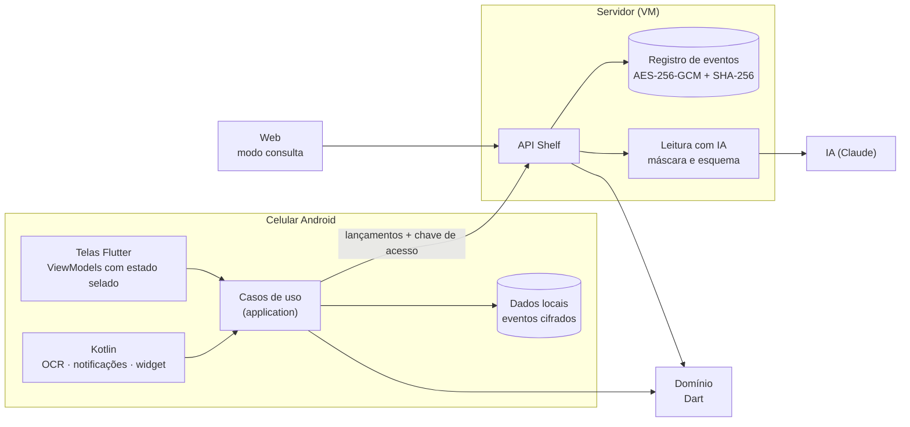
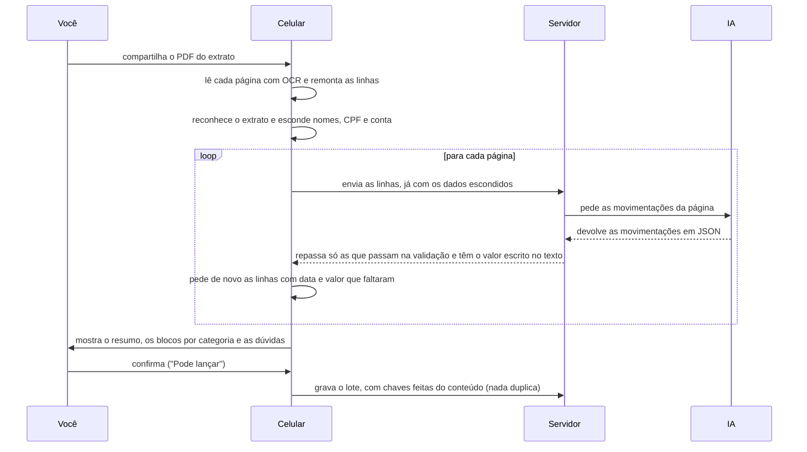

<div align="center">

<sub>**Português** · [English](README.en.md)</sub>


# Cajui

**Controle suas finanças conversando com o app.**

App Android de finanças pessoais com uma assistente de IA: você conversa para lançar gastos, e o app lê extratos e
comprovantes e responde com os números do mês. É um projeto completo, feito do zero: especificação, domínio em Dart, app Flutter, servidor próprio na nuvem e um design system com gallery publicada.

<picture>
  <source media="(prefers-reduced-motion: reduce)" srcset="docs/media/extrato-pela-juju.png" />
  
</picture>

<sub>Gravado com o app rodando, com dados fictícios. Nenhum número é real.</sub>


**[Ver a gallery do design system ao vivo](https://cajui-teal.vercel.app/gallery/)**

[Visão geral](#visão-geral) · [Arquitetura](#arquitetura) · [Documentação da API](docs/api.md) ·
[Decisões (32 ADRs)](docs/architecture/adr) · [Especificação](docs/spec) · [Design system](packages/design_system) ·
[Segurança](docs/security) · [Wireframes](docs/design/wireframes.html)

</div>

---

**Quem quer conhecer o projeto:** [Visão geral](#visão-geral) · [Telas](#telas-e-design-system) · [Arquitetura](#arquitetura) ·
[Problemas e soluções](#problemas-técnicos-e-soluções) · [Tecnologias](#tecnologias) · [Padrões de projeto](#padrões-de-projeto-aplicados) ·
[Segurança](#segurança-e-privacidade) · [Qualidade](#qualidade-e-testes) · [Falhas e correções](#falhas-encontradas-e-correções)<br />
**Quem quer rodar o projeto:** [Como rodar](#como-rodar-o-projeto) · [Scripts](#scripts) · [Estrutura](#estrutura-do-projeto) ·
[Publicação](#como-é-publicado)

## Visão geral

O Cajui é um app Android de finanças pessoais que comecei para controlar as contas da minha casa, no lugar de uma
planilha que dava trabalho para manter. A primeira versão era a planilha em formato de app, e eu mesmo achei cansativo preencher tudo. Por isso mudei o foco: em vez de telas para preencher, você conversa com uma assistente (a
Juju), e o app aproveita o que o banco já envia, como notificações, extratos e comprovantes. Hoje dois celulares usam os
mesmos lançamentos, sincronizados, e existe uma página web só para consultar.

Além de ferramenta pessoal, o projeto virou o meu laboratório para aprender e praticar engenharia de software de
verdade: MVVM, DDD (linguagem do negócio e regras dentro do domínio), princípios SOLID, arquitetura limpa, injeção de
dependência e padrões de projeto como Factory, Strategy, Adapter, Repository, Observer e Singleton (aqui, as instâncias
únicas ficam por conta dos providers do Riverpod). O quadro de [padrões aplicados](#padrões-de-projeto-aplicados) mostra
onde cada um aparece no código, e as decisões estão registradas em [ADRs](docs/architecture/adr).

**Como foi feito:** eu escrevi as especificações do que o app deveria fazer e fui construindo o projeto com o apoio do
Claude, como assistente de programação. A API do Claude também é usada dentro do app, na conversa com a Juju.

### O que o app faz

- **Lançamento por conversa.** Você escreve ou fala "gastei 35 no mercado", e o app cria o lançamento com categoria e
  forma de pagamento. Dá para desfazer logo em seguida.
- **Perguntas sobre o mês.** A assistente responde quanto sobra, o que vence e quanto falta para fechar o mês, usando
  os números do próprio app.
- **Leitura de extrato.** Você compartilha o PDF ou o print do extrato; o celular lê página por página, e a conversa
  confere por blocos antes de gravar. Ler o mesmo extrato duas vezes não duplica lançamentos.
- **Notificações do banco.** Uma compra aprovada vira lançamento automaticamente, com opção de desfazer. Quando entra
  dinheiro, o app pede para você confirmar.
- **Comprovantes.** Foto, print ou PDF viram uma proposta de lançamento para você conferir. O reconhecimento do texto
  acontece no aparelho, e só texto com os dados pessoais mascarados vai para a IA.
- **Dois celulares, os mesmos dados.** Os lançamentos sincronizam entre os aparelhos, e a consulta pela web é protegida por um
  código de autenticador.
- **Regras de dinheiro explícitas.** Cartão de crédito é forma de pagamento, não despesa. Vale-alimentação é uma moeda
  separada, que não se soma ao dinheiro. As duas regras estão nos tipos do domínio.

### Resumo técnico

| Área            | O que foi feito                                                                                                | Onde ver |
| --------------- | -------------------------------------------------------------------------------------------------------------- | -------- |
| Arquitetura     | Arquitetura limpa por feature, MVVM com estado selado (Riverpod), Coordinator e injeção de dependência centralizada; um verificador próprio confere as camadas | [ADR-001](docs/architecture/adr/ADR-001-monorepo-e-dominio-compartilhado.md), [002](docs/architecture/adr/ADR-002-estado-com-riverpod.md), [031](docs/architecture/adr/ADR-031-navegacao-com-coordinator.md) |
| Domínio         | Dart, compartilhado entre app e servidor; `Result` e `Failure` selados; dinheiro em centavos inteiros; regras de negócio numeradas, cada uma com teste | [`packages/domain`](packages/domain) |
| IA              | Claude (API de Mensagens, com *tool use*) atrás de uma interface trocável; dados pessoais mascarados antes de sair; todo valor que a IA escreve é conferido | [ADR-010](docs/architecture/adr/ADR-010-integracao-com-a-deepseek.md), [021](docs/architecture/adr/ADR-021-assistente-que-age.md), [030](docs/architecture/adr/ADR-030-extrato-pela-juju.md) |
| Servidor        | Dart + Shelf, executável único, na Oracle Cloud (OCI), com TLS; registro de eventos cifrado e encadeado; API documentada | [`server/`](server), [`docs/api.md`](docs/api.md) |
| Design system   | Pacote próprio com tokens, componentes, movimento 3D e sons; gallery publicada com os estados de tela | [`packages/design_system`](packages/design_system), [gallery](https://cajui-teal.vercel.app/gallery/) |
| Android nativo  | Compartilhamento, OCR no aparelho, notificações do banco, widget da tela inicial, lembretes e entrada por voz | [`app/android`](app/android) |
| Qualidade       | 1.850 testes, nomeados pela regra que provam; cobertura de 86% a 93% por pacote; varredura de segredos no histórico | [`tool/`](tool), [quality-gates](docs/spec/quality-gates.md) |
| Processo        | 32 ADRs, Conventional Commits, pull requests e CI no GitHub Actions | [`docs/architecture`](docs/architecture) |

### Duas decisões que moldaram o projeto

Duas decisões moldaram o resto. A primeira: a IA só lê e sugere; quem faz conta e aplica as regras é o domínio, em
Dart, usado tanto no app quanto no servidor. A segunda: na conversa do extrato, as frases da Juju são montadas
pelo app a partir dos números do domínio, e não pelo modelo, então o que ela diz bate com o que a tela mostra.

### Como usar este repositório

- **Rodar o app.** Clone o repositório, rode `flutter pub get` e `flutter run`. Sem servidor configurado, ele funciona
  sozinho no aparelho (veja [Como rodar o projeto](#como-rodar-o-projeto)).
- **Ligar a um servidor seu.** O servidor em [`server/`](server) roda na sua máquina com `scripts/servidor-local.ps1`;
  o app aponta para ele pelas variáveis `CAJUI_API_URL` e `CAJUI_ACCESS_KEY`. A chave da IA fica fora do repositório.
- **Reaproveitar o design system.** O pacote [`packages/design_system`](packages/design_system) não depende do app nem
  do Riverpod, e a [gallery](https://cajui-teal.vercel.app/gallery/) mostra cada componente em todos os estados.
- **Reaproveitar o domínio.** O pacote [`packages/domain`](packages/domain) é Dart, sem Flutter (dinheiro, parcelas, fatura de
  cartão, orçamento do mês) e serve para outro app ou servidor.
- **Estudar as decisões.** As [ADRs](docs/architecture/adr) explicam o porquê de cada escolha, e a
  [documentação da API](docs/api.md) descreve cada rota do servidor.

## Telas e design system

<p align="center">
  
  <br /><sub>O extrato pela Juju: resumo, blocos por categoria, dúvidas uma a uma e o lote inteiro com "Desfazer tudo".</sub>
</p>

<p align="center">
  
  <br /><sub>O Início com o carrossel 3D, o Meu mês com dinheiro e vale sempre separados, e a carteira de cartões.</sub>
</p>

<p align="center">
  
  <br /><sub>A gallery do design system: cada componente, estado e tela do app, navegável, com som e tema escuro ·
  <a href="https://cajui-teal.vercel.app/gallery/">ver ao vivo</a> · <a href="packages/design_system">o README dela</a></sub>
</p>

<p align="center">
  
  <br /><sub>O widget de vidro e a chegada no app, gravados na gallery com números inventados.</sub>
</p>

## Arquitetura

Arquitetura limpa, organizada por feature (`features/<x>/{application,infrastructure,presentation}`). O
`composition.dart` é o único lugar que liga uma porta a um adaptador, e nenhuma conta mora no app: ele pergunta ao
domínio.



**Como um extrato vira lançamentos**, do momento em que você o compartilha até a gravação:



Detalhes nas [ADRs](docs/architecture/adr): a [030](docs/architecture/adr/ADR-030-extrato-pela-juju.md) é a do
extrato, a [020](docs/architecture/adr/ADR-020-chave-da-casa.md) é a do acesso, a
[022](docs/architecture/adr/ADR-022-a-ia-le-a-foto.md) é a da foto lida pela IA.

### App Flutter

O app é Flutter, em arquitetura limpa organizada por feature: cada uma tem `application` (casos de uso),
`infrastructure` (adaptadores) e `presentation` (telas e ViewModels).

- **MVVM com estado selado.** A tela só desenha; o ViewModel é um `Notifier` do Riverpod, e o estado é uma hierarquia
  selada, então um `switch` exaustivo faz estado novo sem desenho não compilar.
- **Navegação por Coordinator.** Cada feature tem um coordinator sobre a porta `SceneNavigator`: a tela diz o que a
  pessoa tocou, e o coordinator decide qual cena abrir. ViewModel nunca navega.
- **Injeção de dependência centralizada.** Todas as dependências (repositórios, serviços, adaptadores) são cadastradas
  em um único arquivo, o `composition.dart`. Um verificador automático impede que uma camada interna importe uma
  externa. As regras de negócio não ficam no app: ele consulta o domínio.
- **Offline primeiro.** Os dados ficam no aparelho, cifrados, como um histórico de eventos (cada lançamento é um evento), e sincronizam quando há rede.
- **Aparência só pelo design system.** Cores, tipografia, espaçamentos e durações de animação vêm do pacote do design
  system, nunca do código das telas. O app usa `WidgetsApp` em vez de `MaterialApp` para não herdar o visual do
  Material, e uma verificação automática bloqueia qualquer cor ou estilo definido direto numa tela.

### Servidor

Um executável único em Dart (Shelf), rodando numa VM na **Oracle Cloud Infrastructure (OCI)**, na camada gratuita,
atrás de um proxy com TLS automático e gerenciado como serviço do sistema. O que ele faz:

- **Guarda os dados como um registro de eventos.** Cada evento é cifrado com AES-256-GCM e encadeado por SHA-256, então
  qualquer mudança no passado é detectada. Há resumos por arquivo e um backup diário cifrado, copiado para fora da
  máquina.
- **Valida tudo o que chega.** A leitura do JSON é estrita (campo a mais, faltando ou de tipo errado é recusado), as
  regras do domínio são conferidas de novo no servidor, e todo erro sai com o código de um catálogo de 47 códigos.
- **Autentica.** O aparelho entra com uma chave de acesso, um segredo aleatório compartilhado pelos celulares da mesma casa (no projeto, a "chave da casa"); o servidor guarda só o hash e compara em tempo constante. A
  consulta pela web entra com o código do autenticador (TOTP, RFC 6238), que abre uma sessão de leitura de 30 dias, com
  trava depois de cinco erros.
- **Protege.** Limite de taxa por origem, CORS de uma origem só, e segredos em credenciais cifradas do serviço, nunca no
  repositório.
- **Fala com a IA** (próxima seção) e só devolve o que passa no esquema.

Cada rota está documentada, com request, response e erros, em [`docs/api.md`](docs/api.md).

### Assistente Juju e integração com IA

A Juju é uma assistente de conversa com ***tool use***: o servidor integra a API de Mensagens da Anthropic (Claude) e
oferece ao modelo ferramentas de verdade: lançar um gasto, cancelar, listar, registrar renda, recategorizar e abater
uma dívida. As decisões que valem contar:

- **A IA lê, o domínio decide.** O modelo devolve dado estruturado; quem faz conta e aplica regra é o domínio.
- **Uma porta, vários fornecedores.** O servidor só conhece a interface `ChatClient` (padrão Strategy). Há adaptadores
  para o Claude e para a DeepSeek, escolhidos por configuração, e um cliente de mentira nos testes.
- **Privacidade antes da IA.** Nome de pessoa, CPF e conta são mascarados no celular, antes de o texto sair dele.
- **A resposta da IA é entrada não confiável.** Todo valor em reais que ela escreve é conferido contra o resumo que o
  servidor mandou, as ferramentas e a pergunta. Valor sem origem volta ao modelo uma vez; se ele insistir, sai uma
  resposta de formato fixo.
- **Controle de uso e de falhas.** Há um orçamento mensal de tokens, um tempo máximo por chamada e um disjuntor
  (*circuit breaker*) que para de chamar a IA quando ela começa a falhar. Se a IA ficar fora do ar, o app avisa e você
  continua lançando manualmente.

### Sincronização entre aparelhos

Os dados são um histórico de fatos (lançamentos, correções e cancelamentos). Cada pedido de gravação leva um
identificador único: se o celular reenviar o mesmo pedido, por exemplo depois de uma queda de rede, o servidor
reconhece e não grava de novo. O servidor só guarda e devolve; quem faz as contas é cada celular, com o mesmo domínio.
O app confere o topo do registro a cada 20 segundos e só baixa os dados quando algo mudou. Se o mesmo cartão ou a mesma
categoria forem editados nos dois aparelhos, vale a edição mais recente, e um lançamento cancelado continua cancelado,
mesmo que o outro aparelho ainda o mostre.

### Design system

O design system é um pacote próprio em Dart, [`packages/design_system`](packages/design_system), e o app é o primeiro a
usá-lo:

- **Estilos centralizados.** Cores, fontes, espaçamentos, bordas, sombras, tempos de animação e sons ficam em um só
  lugar e são usados pelo papel que cumprem (por exemplo, "cor do botão de ação"). Trocar a cor de todos os botões é
  editar uma linha, e o teste de contraste roda em seguida.
- **Componentes.** Botões, valores em reais, cartões, campos, avisos, balões de conversa, anéis e linha do tempo do mês,
  cartão de crédito em 3D, painéis de vidro, carrossel e pilha de cartões. Cada um aparece em todos os seus estados.
- **Animação e som.** Efeito de profundidade ao rolar, transições entre telas e um som para cada tipo de controle. A
  animação tem três intensidades e respeita a opção "reduzir movimento" do sistema.
- **Acessibilidade.** Contraste de cores calculado e testado, alvos de toque de pelo menos 48 dp, suporte a fonte
  ampliada e a leitores de tela.
- **Gallery.** Um [site de exemplo](https://cajui-teal.vercel.app/gallery/) com cada componente, cada tela do app nos
  seus estados e as decisões de design, com tema escuro e opções de som e de animação.

### Módulos nativos (Android)

Os módulos em Kotlin cobrem o que o Flutter não alcança: receber compartilhamento de imagem, PDF e texto; OCR no
aparelho com ML Kit (o PDF é rasterizado pelo próprio Android); leitura das notificações dos bancos; o widget de vidro da
tela inicial; lembretes de vencimento; entrada por voz (falar em vez de digitar); e a chave do aparelho guardada no Keystore.

## Problemas técnicos e soluções

Cada item descreve o problema, a solução e o resultado.

### 1. Ler um extrato inteiro sem duplicar lançamentos

- **Problema:** um extrato mensal tem dezenas de linhas, e a primeira versão lia só as 30 primeiras. Além disso, ler o
  mesmo extrato duas vezes, ou desfazer e lançar de novo, não podia gerar lançamentos duplicados.
- **Solução:** o celular envia o extrato à IA página por página (`POST /v1/statements/read-part`), e a IA apenas lê o
  texto. As frases da conversa são montadas pelo app ([`StatementDigest`](packages/domain/lib/src/statements/statement_digest.dart), [`StatementWords`](packages/domain/lib/src/statements/statement_words.dart)). Para evitar duplicatas, cada linha
  gravada recebe um identificador calculado a partir do conteúdo dela, e não da posição na página
  ([`StatementLineKey`](packages/domain/lib/src/statements/statement_line_key.dart)), mais um carimbo que identifica aquele lançamento. Ao ler um extrato, o app compara cada linha com o
  que já está gravado, uma a uma, por valor, dia e nome ([`StatementMatches`](app/lib/src/features/statements/application/statement_matches.dart)), e marca as repetidas como "já está no Cajui".
- **Resultado:** ler o mesmo extrato de novo mostra "já estava no Cajui". Duas compras iguais na mesma padaria continuam
  sendo duas, porque cada uma casa com uma linha do extrato. E "Desfazer tudo" seguido de "Pode lançar" grava os
  lançamentos de novo, com identificadores que ainda não foram cancelados.

### 2. OCR que embaralha tabelas

- **Problema:** no primeiro teste no celular, a linha "Restaurante Sabor" apareceu com o valor da linha do mercado. O
  ML Kit (o OCR do Google) devolve o texto em blocos, e, numa página em forma de tabela, cada coluna vira um bloco
  separado. O OCR também às vezes quebra números ("+3.120,,00", "-32, 80"), e o servidor descartava essas linhas sem
  avisar.
- **Solução:** o código nativo reagrupa o texto de cada página em linhas, pela posição vertical dos pedaços
  ([`TextRows.kt`](app/android/app/src/main/kotlin/app/cajui/capture/TextRows.kt)); o domínio conserta os números quebrados ([`OcrLine`](packages/domain/lib/src/statements/ocr_line.dart)); e o celular confere a resposta da IA: se uma
  linha com data e valor não foi citada, ela é pedida de novo, e o que ainda faltar é informado ao usuário
  ([`MissedLines`](app/lib/src/features/statements/application/missed_lines.dart)).
- **Resultado:** nenhuma linha some sem aviso. Os casos encontrados no celular viraram testes, com as linhas exatas que
  o OCR leu.

### 3. Cartão e vale-alimentação: regras de dinheiro no domínio

- **Problema:** na planilha que eu usava, a compra no cartão contava no mês em que foi feita, e não no mês da fatura, e
  o vale-alimentação não era tratado como dinheiro. Um app que soma tudo em um total só erra o mês inteiro.
- **Solução:** todo valor do mês é um `TenderAmounts`, que guarda dinheiro e vale em campos separados; não existe
  operação que some os dois. A fatura é uma visão calculada, nunca um lançamento, e a compra parcelada vira um
  compromisso na lista de dívidas, parcela a parcela.
- **Resultado:** o compilador recusa a soma errada. O pagamento da fatura que aparece num extrato é marcado como "não
  conta", para a mesma despesa não ser contada duas vezes.

### 4. Proteger dados pessoais antes da IA

- **Problema:** extratos e comprovantes trazem o nome de quem recebeu o Pix, o CPF e o número da conta.
- **Solução:** a máscara roda no celular, antes de qualquer envio ([`PiiRedactor`](packages/domain/lib/src/receipts/pii_redactor.dart), [`TransferLine`](packages/domain/lib/src/statements/transfer_line.dart)). O nome verdadeiro fica no
  aparelho e só aparece na pergunta feita ao usuário ("Pix para Carla M Souza"). A resposta da IA passa por um esquema
  fechado de campos, e todo valor precisa estar escrito no texto enviado. Respostas guardadas que citam uma pessoa nunca
  são usadas como exemplo para a IA.
- **Resultado:** a IA recebe "PIX ENVIADO [NOME] 150,00", e o celular mostra o nome. Uma suíte de testes com
  comprovantes maliciosos tenta injetar instruções no texto (*prompt injection*).

<details>
<summary><b>Mais 5 problemas: sincronização, verificador de código, transição de telas, som e widget de vidro</b></summary>

### 5. Sincronizar dois celulares

- **Problema:** dois celulares usam as mesmas contas, e cada um às vezes lança sem internet.
- **Solução:** os dados são um registro de eventos: nada é apagado, e corrigir ou cancelar acrescenta um novo evento. Os
  identificadores nascem do conteúdo, e, se a mesma coisa for editada nos dois lados, vale a edição mais recente
  ([ADR-019](docs/architecture/adr/ADR-019-dois-aparelhos-um-livro.md)). Com o app aberto, cada aparelho pergunta ao servidor, a cada 20 segundos, por um número que só muda quando
  os dados mudam ([ADR-024](docs/architecture/adr/ADR-024-sincronia-ao-vivo-e-auth-simples.md)).
- **Resultado:** o que um celular lança aparece no outro em poucos segundos, e baixar os dados de novo nunca duplica
  nada.

### 6. Regras de código verificadas automaticamente

- **Problema:** uma arquitetura limpa mantida só por combinado se desfaz no primeiro prazo apertado.
- **Solução:** um verificador próprio, escrito com `package:analyzer` ([`tool/code_metrics`](tool/code_metrics)), roda antes de cada commit e no CI.
  Ele reprova import que vai de uma camada de fora para uma de dentro, arquivo com mais de 300 linhas, função com mais
  de 30, mais de 3 níveis de bloco, dois tipos públicos no mesmo arquivo e cor escrita direto numa tela.
- **Resultado:** todos os arquivos são conferidos a cada commit, e nenhum passa dos limites. Trocar a cor de todos os
  botões é mudar um valor no design system.

### 7. Transição que mostrava duas telas ao mesmo tempo

- **Problema:** ao abrir uma tela, a anterior continuava visível por baixo da nova durante alguns quadros.
- **Solução:** a transição entre telas passou a usar um único relógio linear ([`CameraMove`](packages/design_system/lib/src/motion/camera_move.dart)): a tela de trás sai por
  completo antes de a nova entrar.
- **Resultado:** conferido no celular com gravação de tela, quadro a quadro, e protegido por um teste que falha com o
  código antigo.

### 8. Sons que o alto-falante do celular consegue tocar

- **Problema:** os sons escolhidos vinham em MP3, com silêncio no começo e volumes diferentes entre si. No celular,
  quase não eram ouvidos, mesmo no volume máximo: o alto-falante de um telefone mal reproduz abaixo de 300–400 Hz, e o
  clique do botão tinha 99% da energia entre 150 e 300 Hz.
- **Solução:** cortei o silêncio inicial e suavizei o começo (2 ms) e o fim de cada som. Depois, escrevi um script de
  masterização ([`level_sounds.py`](tool/sound/level_sounds.py)) que cria harmônicos a partir dos graves (o ouvido reconstrói a nota), corta o subgrave e satura
  de leve até o volume-alvo de cada grupo de controles, medido do jeito que o celular reproduz (ponderação K, da norma
  ITU-R BS.1770). A origem e a licença de cada arquivo estão em [`CREDITS.md`](packages/design_system/assets/CREDITS.md).
- **Resultado:** botão de ação, cartão, tecla, interruptor e chip têm cada um o seu som, definido como item do design
  system, e um teste reprova qualquer som que volte a ficar baixo demais para o alto-falante.

### 9. Widget com efeito de vidro no Android

- **Problema:** o widget da tela inicial devia ter aparência de vidro, mas o Android desenha widgets em outro processo
  (`RemoteViews`), sem desfoque do papel de parede, sem shaders e sem animação própria.
- **Solução:** o fundo é uma "aurora" de luz difusa, feita com camadas de gradiente radial, e o vidro é uma película
  translúcida com borda de luz: parece fosco porque o que está atrás não tem contorno definido. A raiz do widget é
  marcada como `@android:id/background`, o que faz o Android 12 ou mais novo abrir o app crescendo a partir do widget.
  Dentro do app, a rota `widget` toca a animação de chegada ([`CajuiGlassArrival`](packages/design_system/lib/src/motion/cajui_glass_arrival.dart)), em que os números do Início atravessam o vidro
  com a aurora acesa ao fundo.
- **Resultado:** a mesma composição existe como componentes do design system (`CajuiAurora`, `CajuiGlassPanel`,
  `CajuiOrb`), e a gallery mostra o gesto inteiro, do toque no widget à chegada no app.

</details>

## Tecnologias

| Camada            | Tecnologias                                                                                            |
| ----------------- | ------------------------------------------------------------------------------------------------------ |
| App               | Flutter 3.47 (Android para usar, web para consultar), Riverpod 3 com estado selado, Dart 3.13          |
| Nativo (Android)  | Kotlin: compartilhamento, OCR com ML Kit no aparelho, leitura de notificações, widget, lembretes       |
| Domínio           | Dart, sem Flutter e sem `dart:io`: o mesmo código no celular e no servidor                        |
| Servidor          | Dart + Shelf, compilado em executável único, numa VM da Oracle Cloud (OCI), com proxy TLS e serviço do sistema               |
| Dados             | Registro de eventos cifrado com AES-256-GCM e encadeado por SHA-256, backup diário                     |
| IA                | Claude (API de Mensagens, com ferramentas) ou DeepSeek, atrás da mesma porta `ChatClient`                  |
| Design system     | Pacote próprio com tokens, componentes, vidro, movimento 3D e sons; gallery publicada na Vercel        |
| Qualidade         | `very_good_analysis`, verificador próprio, cobertura com piso por pacote, varredura de segredos        |
| Esteira           | GitHub Actions, Conventional Commits, Vercel para a web                                                |

## Padrões de projeto aplicados

O Cajui também é o meu trabalho de Dispositivos Móveis II, que pede o app e o design system seguindo os padrões
estudados no semestre. A regra que segui foi **um padrão por pergunta**, sem misturar dois para a mesma coisa.

| Pergunta      | Padrão escolhido                                                            | Onde está                                                                                                                                                                                       |
| ------------- | --------------------------------------------------------------------------- | ----------------------------------------------------------------------------------------------------------------------------------------------------------------------------------------------- |
| Uma tela      | MVVM: a tela só desenha, o `Notifier` do Riverpod decide, o estado é selado | [`entries_view_model.dart`](app/lib/src/features/ledger/presentation/entries_view_model.dart)                                                                                                   |
| O app inteiro | Camadas (Clean), travadas por um verificador                                | [`layer_rules.dart`](tool/code_metrics/lib/src/layer_rules.dart) · [ADR-001](docs/architecture/adr/ADR-001-monorepo-e-dominio-compartilhado.md)                                                 |
| Navegação     | Coordinator: o ViewModel diz o que houve, o Coordinator decide para onde ir | [`core/navigation`](app/lib/src/core/navigation) · [ADR-031](docs/architecture/adr/ADR-031-navegacao-com-coordinator.md)                                                                        |
| Dependências  | Injeção de dependência com Riverpod, configurada em um único arquivo                     | [`composition.dart`](app/lib/src/app/composition.dart) · [ADR-002](docs/architecture/adr/ADR-002-estado-com-riverpod.md), [ADR-032](docs/architecture/adr/ADR-032-injecao-e-factory-de-cena.md) |
| Pastas        | Por feature: `features/<x>/{application,infrastructure,presentation}`       | uma pasta por cena                                                                                                                                                                              |
| Repositório   | Monorepo de pacotes                                                         | [`packages/`](packages) · [ADR-001](docs/architecture/adr/ADR-001-monorepo-e-dominio-compartilhado.md)                                                                                          |

<details>
<summary><b>Componentes da arquitetura e onde estão no código</b></summary>

| Componente                           | No código                                                                                                                                                                                                                                                                                                                         |
| -------------------------------------- | -------------------------------------------------------------------------------------------------------------------------------------------------------------------------------------------------------------------------------------------------------------------------------------------------------------------------------- |
| Core (modelos, repositórios, `Result`) | [`packages/domain`](packages/domain) e [`packages/api_contract`](packages/api_contract)                                                                                                                                                                                                                                          |
| Design System                          | [`packages/design_system`](packages/design_system)                                                                                                                                                                                                                                                                               |
| Cena                                   | Uma pasta por feature, com `application`, `infrastructure` e `presentation`                                                                                                                                                                                                                                                      |
| Factory de cena                        | O Coordinator monta a tela e o provider do ViewModel entrega as dependências ([ADR-032](docs/architecture/adr/ADR-032-injecao-e-factory-de-cena.md))                                                                                                                                                                             |
| Coordinator                            | Um por feature, em `presentation`, sobre a porta [`SceneNavigator`](app/lib/src/core/navigation/scene_navigator.dart): [`LedgerCoordinator`](app/lib/src/features/ledger/presentation/ledger_coordinator.dart), `BudgetCoordinator`, `CardsCoordinator`… ([ADR-031](docs/architecture/adr/ADR-031-navegacao-com-coordinator.md)) |
| View                                   | `*_page.dart`, só desenha, com os componentes do design system                                                                                                                                                                                                                                                                   |
| ViewModel                              | `*_view_model.dart` (um `Notifier`), com o estado selado ao lado                                                                                                                                                                                                                                                                 |
| Server                                 | A porta da feature (`AssistantGateway`, `LedgerDownlink`…) e o adaptador HTTP em `infrastructure`                                                                                                                                                                                                                                |
| Storage                                | `PreferencesStore`, `HouseholdKeyStore` e o registro de eventos, cada um com versão real e em memória                                                                                                                                                                                                                               |

</details>

<details>
<summary><b>Padrões de projeto: exemplos no código</b></summary>

| Padrão     | Exemplo no código                                                                                                                                                                                                                                                          |
| ---------- | --------------------------------------------------------------------------------------------------------------------------------------------------------------------------------------------------------------------------------------------------------------------- |
| Factory    | `factory of(...)` em [`home_view.dart`](app/lib/src/features/home/application/home_view.dart) e [`statement_view.dart`](app/lib/src/features/cards/application/statement_view.dart)                                                                                   |
| Adapter    | [`NativeReceiptReader`](app/lib/src/features/receipts/infrastructure/native_receipt_reader.dart) encaixa o OCR do Android na porta `ReceiptReader`; [`HttpAssistantGateway`](app/lib/src/features/assistant/infrastructure/http_assistant_gateway.dart) encaixa a API |
| Strategy   | [`ChatClient`](server/lib/src/ai/chat_client.dart) com [`DeepSeekChatClient`](server/lib/src/ai/deepseek_chat_client.dart) e [`ClaudeChatClient`](server/lib/src/ai/claude_chat_client.dart), escolhido na subida do servidor                                         |
| Observer   | `ref.watch` do Riverpod nas telas e `Stream` na sincronização ao vivo                                                                                                                                                                                                 |
| Repository | [`LedgerJournal`](app/lib/src/features/ledger/application/ledger_journal.dart), com versão local, remota e em memória                                                                                                                                                 |
| Result     | [`Result` e `Failure` selados](packages/domain/lib/src/shared/result.dart): regra recusada é valor, e não exceção; [`Decoded`](packages/api_contract/lib/src/decoded.dart) faz o mesmo com o pedido que vem de fora                                                   |

</details>

**Entregas da disciplina:**

| Entrega                               | Onde está                                                                                                                                |
| ------------------------------------- | ---------------------------------------------------------------------------------------------------------------------------------------- |
| Tema do app                           | [Problema e público](docs/spec/problem.md) e [marca](docs/brand)                                                                         |
| Protótipo das telas                   | [Wireframes de baixa fidelidade](docs/design/wireframes.html): mapa de navegação, 14 telas e os estados                                  |
| Componentes e sample do design system | [`packages/design_system`](packages/design_system) e a [gallery ao vivo](https://cajui-teal.vercel.app/gallery/), que é o app de exemplo |
| Documentação da API                   | [`docs/api.md`](docs/api.md): cada rota com request, response e erros                                                                    |

## Segurança e privacidade

- **Uma chave de acesso** de 32 bytes aleatórios, gerada no computador de quem instala e compilada no APK. O servidor guarda só
  o hash, numa credencial cifrada do systemd ([ADR-020](docs/architecture/adr/ADR-020-chave-da-casa.md)).
- **A web entra com código de autenticador** (TOTP, RFC 6238), e o segredo também fica cifrado na VM
  ([ADR-027](docs/architecture/adr/ADR-027-codigo-do-autenticador.md)).
- **A chave da IA existe só no servidor**, nunca no app, no bundle web ou no repositório. Um verificador varre a
  árvore **e o histórico inteiro** a cada commit e a cada PR.
- **Dados cifrados em repouso:** cada registro com AES-256-GCM e encadeado por SHA-256. Dá para provar que ninguém
  mexeu no passado.
- **Máscara antes da IA e resposta da IA como entrada hostil**, como no [problema 4](#4-proteger-dados-pessoais-antes-da-ia).
- Modelo de ameaças em STRIDE e checklist ASVS nível 2 em [`docs/security`](docs/security). Onde um controle **não**
  está implementado, está escrito que não está.

## Qualidade e testes

| Item                | Situação                                                                                                  |
| ------------------- | --------------------------------------------------------------------------------------------------------- |
| Testes              | **1.850**: app 611 · domínio 493 · servidor 253 · design system 257 · contrato 104 · gallery 81 · persistência 25 · verificador 26 |
| Cobertura           | contrato 93,2% · domínio 92,9% · persistência 91,5% · servidor 89,9% · design system 88,0% · app 86,4%   |
| Regra ↔ teste       | Cada regra tem número (`RN-xxx`) e um teste com o mesmo número. Exemplo numérico da especificação vira teste, centavo a centavo |
| Textos              | Todo erro que a pessoa lê vem de um catálogo de 47 códigos, e o código que o exibe é **gerado** dele. Um teste por código garante que nenhum texto sai com marcador por preencher |
| Voz                 | Termos proibidos ("déficit", "estourou", exclamação) são reprovados por teste em todas as frases do app |
| Analisador          | `very_good_analysis`, zero aviso                                                                          |
| Verificador próprio | nenhum limite de tamanho ou de camadas estourado                                                                     |
| Acessibilidade      | Lighthouse 100 na web; semântica ligada desde a raiz; o leitor de tela diz quem fala na conversa         |

## Falhas encontradas e correções

Problemas reais que apareceram durante o desenvolvimento e o que cada um ensinou:

- **Testes passando, defeito no celular.** A leitura de extrato passou em centenas de testes, mas o primeiro PDF real
  misturou colunas ([problema 2](#2-ocr-que-embaralha-tabelas)). Antes disso, o app lia o corpo da resposta de erro da
  API no lugar errado, e o teste não percebeu porque o servidor falso imitava o que o app esperava, e não o que o
  servidor de verdade envia.
- **Compra parcelada contada inteira no mês da compra.** O domínio já calculava certo, mas uma camada do app somava por
  conta própria em vez de consultá-lo. Era um conceito central do produto funcionando errado.
- **Três mensagens de erro saíam com o valor em branco.** Um teste que percorre todos os códigos de erro da leitura de
  extrato encontrou três textos com marcador sem preencher.
- **A versão web nunca tinha rodado.** O cliente HTTP do `dart:io` falha ao ser criado no navegador, e o app parava antes
  do primeiro quadro, sem mensagem de erro.
- **Compartilhamento ilegível fechava o app ao abrir.** Qualquer app pode enviar um arquivo inválido de propósito.

Todos foram achados em revisão de código ou no uso real, e hoje cada um tem um teste que cobre o caso.

## Custo de operação

**R$ 0,00 fixo.** VM gratuita na Oracle, TLS do Let's Encrypt, DNS dinâmico gratuito, repositório e esteira no GitHub
e a web na Vercel, no plano Hobby. O único custo variável é a IA, cobrada por uso: com a DeepSeek a conta fica em **cerca de R$ 0,60 por mês** no
cenário de 120 lançamentos ([a conta está aqui](docs/ops/ai-cost-estimate.md)); o Claude custa mais por token, e a
troca é só de configuração.

---

## Guia para desenvolvedores

### Como rodar o projeto

**Pré-requisitos:** Flutter 3.47 (com Dart 3.13), Android SDK e um aparelho ou emulador Android. Python 3 só para os
verificadores da esteira.

```bash
git clone https://github.com/Marcos-Codfy/finance-cajui.git
cd finance-cajui
flutter pub get
cd app && flutter run
```

Sem a chave de acesso compilada, o app nasce sem servidor e funciona sozinho no aparelho. A chave
(`CAJUI_ACCESS_KEY`) e o endereço do servidor (`CAJUI_API_URL`) entram por `--dart-define` e nunca são versionados. A web de consulta sai com
`flutter build web --no-web-resources-cdn` dentro de `app/`.

### Scripts

| Comando (PowerShell, da raiz)          | O que faz                                                                    |
| -------------------------------------- | ---------------------------------------------------------------------------- |
| `.\scripts\apk.ps1 -Release`           | Compila o APK de uso e instala no celular ligado (chave e servidor por variável de ambiente) |
| `.\scripts\servidor-local.ps1`         | Sobe o servidor nesta máquina, lendo a chave da IA de fora do repositório    |
| `dart run tool/code_metrics/bin/check.dart` | Roda o verificador de tamanho e camadas                                  |

<details>
<summary><b>Testes de cada pacote</b></summary>

```bash
cd app && flutter test
cd packages/design_system && flutter test
cd packages/design_system/gallery && flutter test
cd packages/domain && dart test
cd packages/api_contract && dart test
cd packages/persistence && dart test
cd server && dart test
cd tool/code_metrics && dart test
```

</details>

### Estrutura do projeto

<details>
<summary><b>Árvore de pastas</b></summary>

```text
app/                      Flutter: Android para usar, web para consultar
  lib/src/features/       assistant, statements, receipts, ledger, budget, cards, home, export, reminders…
  android/                Kotlin: compartilhamento, OCR, notificações, widget, lembretes
packages/
  domain/                 regras de negócio em Dart
  api_contract/           DTOs, leitura estrita de JSON, catálogo de erros
  persistence/            registro de eventos cifrado, com cadeia de hash
  design_system/          tokens, componentes, movimento, sons
    gallery/              o sample navegável do design system
server/                   Dart + Shelf: API, leitura com IA, sincronização
tool/                     verificadores: tamanho, camadas, segredos, cobertura
docs/                     especificação, ADRs, marca, segurança, custo e desempenho
scripts/                  APK, servidor local e build da web
```

</details>

### Como é publicado

- **Servidor:** um executável único em Dart (`dart compile exe`), compilado na esteira e servido atrás de um proxy com
  TLS. A operação da máquina (provisionamento, serviço, backup) não faz parte desta cópia; as decisões estão nas
  ADRs [003](docs/architecture/adr/ADR-003-backend-dart-shelf.md),
  [005](docs/architecture/adr/ADR-005-criptografia-em-repouso-e-dbtool.md) e
  [011](docs/architecture/adr/ADR-011-hospedagem-a-custo-zero.md).
- **Web:** a Vercel publica a `main`: a web de consulta na raiz e a gallery do design system em `/gallery/`, as duas
  compiladas pelo [`scripts/web.sh`](scripts/web.sh).
- **App:** o APK de uso é gerado e instalado por cabo, com a chave de acesso e o endereço do servidor compilados.

## Créditos

- **Especificação, design e desenvolvimento:** [Marcos Vinicius Muniz Arruda](https://github.com/Marcos-Codfy)
- **Fontes:** Fraunces e Geist (SIL Open Font License)
- **Sons de toque:** Pixabay, sob a Pixabay Content License, tratados no projeto; os demais são sintetizados aqui
  ([origem de cada arquivo](packages/design_system/assets/CREDITS.md))
- **Ícones e ilustrações:** desenhados no próprio projeto

## Licença

[MIT](LICENSE). As fontes e os sons têm as licenças próprias listadas nos créditos acima.

---

<div align="center">

<sub>O nome vem do **cajuí** (<i>Anacardium humile</i>), o cajuzinho rasteiro do Cerrado tocantinense.</sub>

<sub>Feito por <a href="https://github.com/Marcos-Codfy">Marcos Vinicius Muniz Arruda</a> · Palmas-TO · 2026</sub>

</div>
