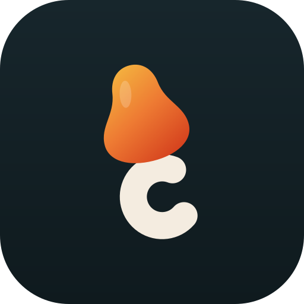
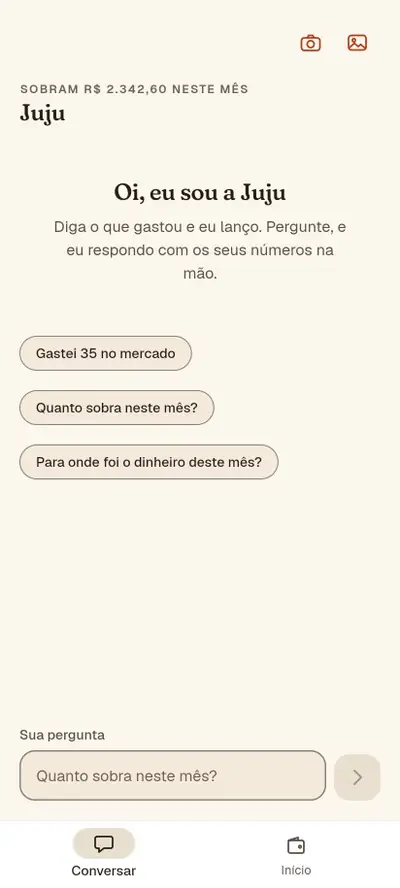
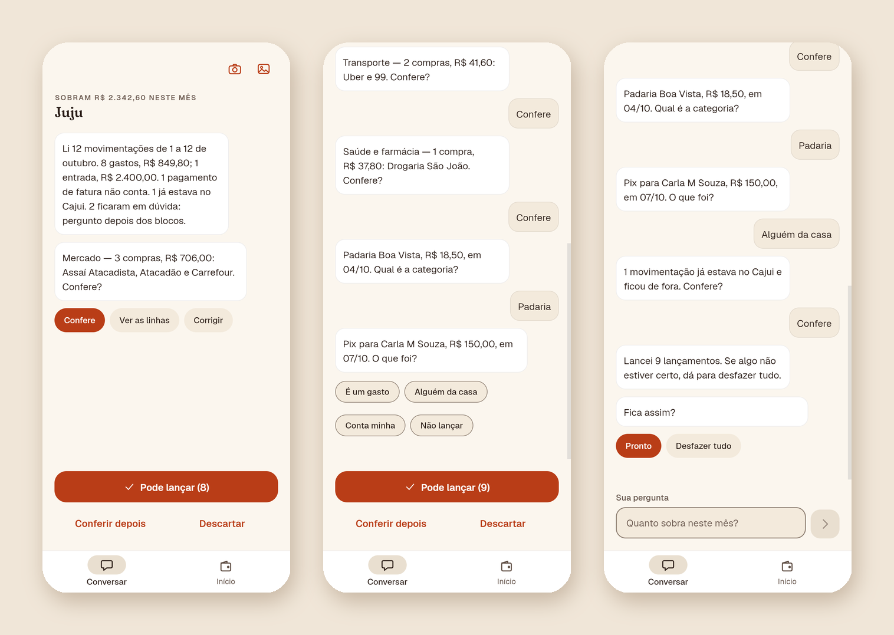
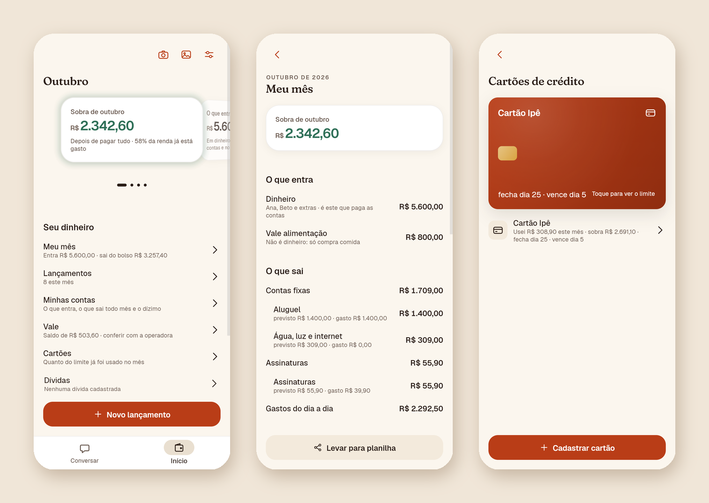
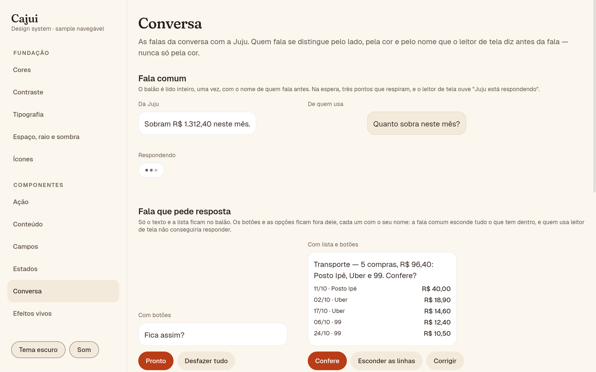
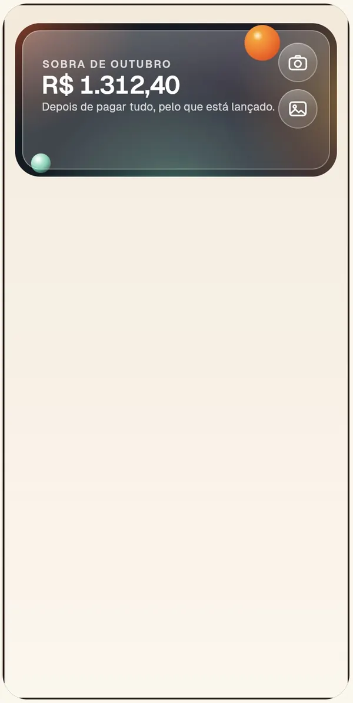
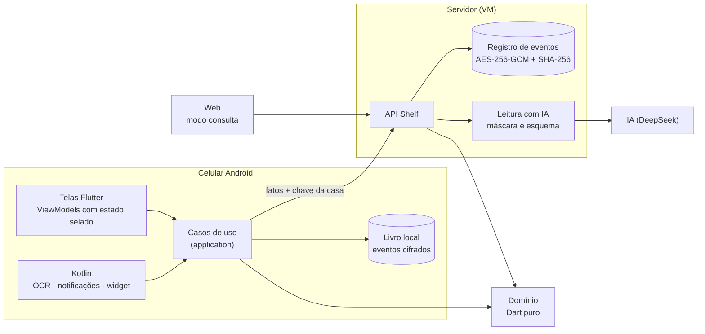
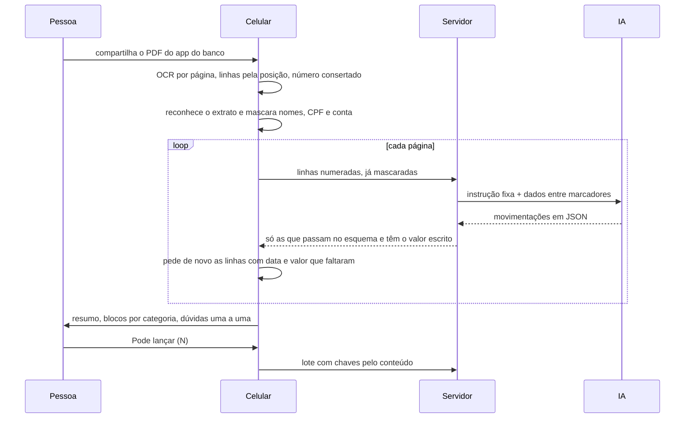

<div align="center">

<sub>**Português** · [English](README.en.md)</sub>



# Cajui

**O dinheiro da casa, numa conversa.**

App de finanças pessoais para Android, com uma assistente que lança o que você diz, lê o extrato que você
compartilha do app do banco e pergunta só o que não sabe. Feito do zero: especificação, domínio em Dart puro, app em
Flutter, servidor próprio, design system e esteira de qualidade. Custo fixo: **R$ 0,00 por mês**.

<picture>
  <source media="(prefers-reduced-motion: reduce)" srcset="docs/media/extrato-pela-juju.png" />
  
</picture>

<sub>Gravado no app de verdade, rodando com uma casa inventada. Nenhum número é de alguém.</sub>


**[Ver a gallery do design system ao vivo](https://cajui-teal.vercel.app/gallery/)**

[Especificação](docs/spec) · [Decisões (32 ADRs)](docs/architecture/adr) · [Design system](packages/design_system) ·
[Segurança](docs/security) · [Operação](docs/ops/runbook.md) · [API](docs/api.md) ·
[Wireframes](docs/design/wireframes.html) · [Progresso](PROGRESS.md)

</div>

---

**Para quem avalia:** [Em 30 segundos](#em-30-segundos) · [Visual](#visual) · [Bastidores](#bastidores) ·
[Desafios que resolvi](#desafios-que-resolvi) · [Stack](#stack) · [Arquitetura](#arquitetura) ·
[Padrões aplicados](#padrões-de-projeto-aplicados) · [Segurança e privacidade](#segurança-e-privacidade) ·
[Qualidade](#qualidade) · [O que deu errado](#o-que-deu-errado)<br />
**Para quem desenvolve:** [Começando](#começando) · [Scripts](#scripts) · [Estrutura](#estrutura-do-projeto) ·
[Deploy](#deploy) · [Roadmap](#roadmap)

## Em 30 segundos

- **Meu papel:** projeto pessoal, do zero e sozinho. Escrevi a especificação (420 regras de negócio numeradas), o
  domínio, o app, a parte nativa em Kotlin, o servidor, o design system com a marca, a infraestrutura e a esteira.
- **O que é:** o app que substituiu a planilha de finanças da minha casa. Dois celulares Android usam o mesmo livro,
  sincronizado ao vivo, e uma página web serve para consultar.
- **O diferencial:**
  - a **Juju** lança o gasto que você diz ("gastei 35 no mercado") e responde com os seus números;
  - ela **lê o extrato** que você compartilha do app do banco, página a página, e confere com você por blocos antes
    de gravar qualquer coisa;
  - a **notificação do banco** de uma compra aprovada vira lançamento sozinha, com "Desfazer"; dinheiro que entrou
    pede um toque. O **comprovante** (foto, print ou PDF) vira proposta pronta para confirmar.
- **Os dois conceitos que quase todo app de finanças erra:** cartão de crédito é forma de pagamento, nunca despesa;
  e vale-alimentação é outra moeda, que nunca se soma ao dinheiro. Os dois são garantidos pelos tipos do domínio, e
  não por disciplina.
- **Privacidade:** o que vai para a IA sai do celular com nome de pessoa, CPF e conta mascarados. A resposta da IA é
  tratada como entrada não confiável: todo valor que ela devolve precisa estar escrito no documento.
- **Engenharia:** arquitetura limpa com as camadas travadas por um verificador próprio, 1.850 testes nomeados pela
  regra que provam, cobertura de 86% a 93% por pacote, 32 ADRs e esteira no GitHub Actions.

## Visual

<p align="center">
  
  <br /><sub>O extrato pela Juju: resumo, blocos por categoria, dúvidas uma a uma e o lote inteiro com "Desfazer tudo".</sub>
</p>

<p align="center">
  
  <br /><sub>O Início com o carrossel 3D, o Meu mês com dinheiro e vale sempre separados, e a carteira de cartões.</sub>
</p>

<p align="center">
  
  <br /><sub>A gallery do design system: cada componente, estado e tela do app, navegável, com som e tema escuro ·
  <a href="https://cajui-teal.vercel.app/gallery/">ver ao vivo</a> · <a href="packages/design_system">o README dela</a></sub>
</p>

<p align="center">
  
  <br /><sub>O widget de vidro e a chegada no app, gravados na gallery com números inventados.</sub>
</p>

## Bastidores

O Cajui começou como substituto de uma planilha que funcionava, mas só funcionava porque alguém a alimentava à mão.
A primeira versão seguia a planilha ao pé da letra, e o veredito de quem usava foi direto: "ficou chato de usar". Daí
saiu a virada do projeto: menos telas, uma assistente que conversa e lança, e o celular trabalhando sozinho (a
notificação do banco vira lançamento; o comprovante compartilhado vira proposta pronta para um toque).

A IA entra onde ajuda, nunca onde decide. Quem faz conta é o domínio, em Dart puro, e o mesmo código roda no celular e
no servidor. A IA lê texto e foto e devolve dado estruturado, que o domínio confere. Na conversa do extrato, nenhuma
frase da Juju passa pelo modelo: o app monta cada uma a partir dos números do domínio, e por isso o que ela diz é
sempre o que a tela mostra.

O detalhe de que mais gosto é o teste no celular de verdade. O extrato passou em centenas de testes, e o primeiro PDF
compartilhado no aparelho mostrou um restaurante com o valor do mercado. Era o OCR devolvendo a tabela por colunas
([desafio 2](#2-a-tabela-que-o-ocr-desmonta)). Desde então, toda tela nova é conferida no navegador e no aparelho
antes de fechar o passo.

## Desafios que resolvi

### 1. O extrato inteiro numa conversa, sem lançar nada em dobro

- **Problema:** um extrato mensal tem dezenas de linhas, e a leitura antiga parava em 30. Ler de novo, compartilhar
  duas vezes ou desfazer e relançar não podia duplicar nada.
- **Solução:** o celular lê página por página (`POST /v1/statements/read-part`), e a IA só lê. A conversa é montada
  pelo app ([`StatementDigest`](packages/domain/lib/src/statements/statement_digest.dart),
  [`StatementWords`](packages/domain/lib/src/statements/statement_words.dart)). Cada linha gravada leva uma chave
  feita do conteúdo, e não da posição ([`StatementLineKey`](packages/domain/lib/src/statements/statement_line_key.dart)),
  mais o carimbo do lançamento. "Já está no Cajui" é casamento um a um, por valor, dia e nome
  ([`StatementMatches`](app/lib/src/features/statements/application/statement_matches.dart)).
- **Resultado:** ler o mesmo extrato de novo mostra "já estava no Cajui"; duas compras iguais na mesma padaria
  continuam sendo duas; e "Desfazer tudo" seguido de "Pode lançar" grava de novo, com ids que nunca foram desfeitos.

### 2. A tabela que o OCR desmonta

- **Problema:** no primeiro teste no aparelho, a linha "Restaurante Sabor" saiu com o valor do mercado. O ML Kit
  devolve o texto por blocos, e numa página em forma de tabela cada coluna vira um bloco. Além disso, o OCR às vezes
  quebra o número ("+3.120,,00", "-32, 80"), e o servidor descartava a linha sem dizer nada.
- **Solução:** o lado nativo remonta cada página em linhas pela altura dos pedaços
  ([`TextRows.kt`](app/android/app/src/main/kotlin/app/cajui/capture/TextRows.kt)); o domínio conserta o número que o
  OCR quebrou ([`OcrLine`](packages/domain/lib/src/statements/ocr_line.dart)); e o celular confere a resposta da IA:
  linha com data e valor que ela não citou é pedida de novo, e o que ainda faltar é dito
  ([`MissedLines`](app/lib/src/features/statements/application/missed_lines.dart)).
- **Resultado:** nenhuma linha some calada. Os casos do aparelho viraram testes com as linhas exatas que o OCR leu.

### 3. Cartão é forma de pagamento; vale é outra moeda

- **Problema:** a planilha sabia que a compra no cartão conta no mês em que foi feita, e não no mês da fatura, e que o
  vale-alimentação não é dinheiro. Um app que soma tudo num total só erra o mês inteiro.
- **Solução:** todo valor do mês é um `TenderAmounts`, com dinheiro e vale em campos separados, e não existe operação
  que junte os dois. A fatura é uma visão calculada, nunca um lançamento; a compra parcelada vira compromisso do
  bloco de dívidas, parcela a parcela.
- **Resultado:** o compilador recusa a soma errada. O pagamento da fatura lido num extrato aparece como "não conta".

### 4. Privacidade antes da IA

- **Problema:** extrato e comprovante trazem nome de quem recebeu o Pix, CPF e número de conta.
- **Solução:** a máscara roda no celular antes de qualquer envio
  ([`PiiRedactor`](packages/domain/lib/src/receipts/pii_redactor.dart),
  [`TransferLine`](packages/domain/lib/src/statements/transfer_line.dart)). O nome de verdade fica no aparelho, e é
  ali que aparece na pergunta ("Pix para Carla M Souza"). A resposta da IA passa por esquema fechado, e todo valor
  precisa estar escrito no texto. Resposta lembrada que fala de pessoa nunca vira exemplo para a IA.
- **Resultado:** a IA vê "PIX ENVIADO [NOME] 150,00" e o celular mostra o nome. Há uma suíte de comprovantes
  maliciosos que tenta injeção de prompt.

<details>
<summary><b>Mais 5 desafios: sincronização, verificador próprio, troca de tela, som e o widget de vidro</b></summary>

### 5. Dois celulares, um livro

- **Problema:** o casal usa dois celulares, e cada um lança sem rede às vezes.
- **Solução:** registro de eventos (nada é apagado; corrigir e cancelar acrescentam), ids que nascem do conteúdo e
  "a edição mais nova vence" ([ADR-019](docs/architecture/adr/ADR-019-dois-aparelhos-um-livro.md)). Com o app na
  frente, cada aparelho pergunta ao servidor, a cada 20 segundos, um número que só anda quando o livro muda
  ([ADR-024](docs/architecture/adr/ADR-024-sincronia-ao-vivo-e-auth-simples.md)).
- **Resultado:** o que um lança aparece no outro em segundos, e descer o livro de novo nunca duplica nada.

### 6. Regras de código que a máquina reprova

- **Problema:** arquitetura limpa só por convenção se desfaz no primeiro prazo apertado.
- **Solução:** um verificador próprio, escrito com `package:analyzer` ([`tool/code_metrics`](tool/code_metrics)),
  roda no pre-commit e na esteira. Ele reprova import de fora para dentro das camadas, arquivo com mais de 300
  linhas, função com mais de 30, mais de 3 níveis de bloco, dois tipos públicos no mesmo arquivo e cor escrita à mão
  numa tela.
- **Resultado:** 1.166 arquivos conferidos a cada commit, nenhum limite estourado. Trocar a cor de todos os botões é
  mudar um token.

### 7. A troca de tela que misturava duas telas

- **Problema:** ao abrir uma tela, a anterior ainda aparecia por baixo da nova por alguns quadros.
- **Solução:** a câmera entre telas virou uma passagem num relógio linear comum
  ([`CameraMove`](packages/design_system/lib/src/motion/camera_move.dart)): a tela de trás sai inteira antes de a
  nova chegar.
- **Resultado:** conferido no aparelho por gravação de tela, quadro a quadro, e preso por um teste que falha com o
  código antigo.

### 8. Um som por família de controle

- **Problema:** os sons escolhidos vinham em MP3, com silêncio no começo e volumes diferentes. No celular, mesmo no
  volume máximo, quase sumiam: o alto-falante de um telefone quase não toca abaixo de 300–400 Hz, e o clique do botão
  tinha 99% da energia entre 150 e 300 Hz.
- **Solução:** corte do silêncio, entrada de 2 ms e saída em cosseno; depois, um masterizador próprio
  ([`level_sounds.py`](tool/sound/level_sounds.py)) gera harmônicos dos graves (o ouvido reconstrói a nota), corta o
  subgrave e satura de leve até o alvo de cada família, medido como o celular ouve (ponderação K da ITU-R BS.1770). A
  origem e a licença de cada arquivo estão em [`CREDITS.md`](packages/design_system/assets/CREDITS.md).
- **Resultado:** botão de ação, cartão, tecla, chave e chip têm cada um o seu som, como token do design system, e um
  teste reprova o som que voltar a ficar baixo demais para o alto-falante.

### 9. Um widget de vidro que o Android não deixa desfocar

- **Problema:** o widget da tela inicial devia ter cara de vidro, mas um widget Android é desenhado por outro processo
  (`RemoteViews`): não há desfoque do papel de parede, sombreador nem animação própria.
- **Solução:** a aurora é só luz difusa, em camadas de gradiente radial, e o vidro é um véu translúcido com borda de
  luz: parece fosco porque o que está atrás já não tem contorno. A raiz do widget é marcada como
  `@android:id/background`, e o Android 12+ abre o app crescendo de dentro dele. No app, a rota `widget` toca a
  chegada ([`CajuiGlassArrival`](packages/design_system/lib/src/motion/cajui_glass_arrival.dart)): os números do
  Início atravessam o vidro, com a aurora acesa atrás.
- **Resultado:** a mesma composição existe em componentes do design system (`CajuiAurora`, `CajuiGlassPanel`,
  `CajuiOrb`), e a gallery mostra o gesto inteiro, do toque no widget à chegada.

</details>

## Stack

| Camada            | Tecnologias                                                                                            |
| ----------------- | ------------------------------------------------------------------------------------------------------ |
| App               | Flutter 3.47 (Android para usar, web para consultar), Riverpod 3 com estado selado, Dart 3.13          |
| Nativo (Android)  | Kotlin: compartilhamento, OCR com ML Kit no aparelho, leitura de notificações, widget, lembretes       |
| Domínio           | Dart puro, sem Flutter e sem `dart:io`: o mesmo código no celular e no servidor                        |
| Servidor          | Dart + Shelf, compilado em executável único, numa VM da Oracle com Caddy (TLS) e systemd               |
| Dados             | Registro de eventos cifrado com AES-256-GCM e encadeado por SHA-256, backup diário                     |
| IA                | DeepSeek (`deepseek-flash`) com ferramentas: lançar, cancelar, listar, registrar renda, ler extrato     |
| Design system     | Pacote próprio com tokens, componentes, vidro, movimento 3D e sons; gallery publicada na Vercel        |
| Qualidade         | `very_good_analysis`, verificador próprio, cobertura com piso por pacote, varredura de segredos        |
| Esteira           | GitHub Actions, Conventional Commits, Vercel para a web                                                |

## Arquitetura

Arquitetura limpa, organizada por feature (`features/<x>/{application,infrastructure,presentation}`). O
`composition.dart` é o único lugar que liga uma porta a um adaptador, e nenhuma conta mora no app: ele pergunta ao
domínio.



**O extrato pela Juju**, do compartilhamento ao lote gravado:



Detalhes nas [ADRs](docs/architecture/adr): a [030](docs/architecture/adr/ADR-030-extrato-pela-juju.md) é a do
extrato, a [020](docs/architecture/adr/ADR-020-chave-da-casa.md) é a do acesso, a
[022](docs/architecture/adr/ADR-022-a-ia-le-a-foto.md) é a da foto lida pela IA.

## Padrões de projeto aplicados

O Cajui também é o meu trabalho de Dispositivos Móveis II, que pede o app e o design system seguindo os padrões
estudados no semestre. A regra que segui foi **um padrão por pergunta**, sem misturar dois para a mesma coisa.

| Pergunta      | Padrão escolhido                                                            | Onde está                                                                                                                                                                                       |
| ------------- | --------------------------------------------------------------------------- | ----------------------------------------------------------------------------------------------------------------------------------------------------------------------------------------------- |
| Uma tela      | MVVM: a tela só desenha, o `Notifier` do Riverpod decide, o estado é selado | [`entries_view_model.dart`](app/lib/src/features/ledger/presentation/entries_view_model.dart)                                                                                                   |
| O app inteiro | Camadas (Clean), travadas por um verificador                                | [`layer_rules.dart`](tool/code_metrics/lib/src/layer_rules.dart) · [ADR-001](docs/architecture/adr/ADR-001-monorepo-e-dominio-compartilhado.md)                                                 |
| Navegação     | Coordinator: o ViewModel diz o que houve, o Coordinator decide para onde ir | [`core/navigation`](app/lib/src/core/navigation) · [ADR-031](docs/architecture/adr/ADR-031-navegacao-com-coordinator.md)                                                                        |
| Dependências  | Injeção com Riverpod, ligada num único composition root                     | [`composition.dart`](app/lib/src/app/composition.dart) · [ADR-002](docs/architecture/adr/ADR-002-estado-com-riverpod.md), [ADR-032](docs/architecture/adr/ADR-032-injecao-e-factory-de-cena.md) |
| Pastas        | Por feature: `features/<x>/{application,infrastructure,presentation}`       | uma pasta por cena                                                                                                                                                                              |
| Repositório   | Monorepo de pacotes                                                         | [`packages/`](packages) · [ADR-001](docs/architecture/adr/ADR-001-monorepo-e-dominio-compartilhado.md)                                                                                          |

<details>
<summary><b>As peças da aula e onde elas moram no Cajui</b></summary>

| Peça da aula                           | No Cajui                                                                                                                                                                                                                                                                                                                         |
| -------------------------------------- | -------------------------------------------------------------------------------------------------------------------------------------------------------------------------------------------------------------------------------------------------------------------------------------------------------------------------------- |
| Core (modelos, repositórios, `Result`) | [`packages/domain`](packages/domain) e [`packages/api_contract`](packages/api_contract)                                                                                                                                                                                                                                          |
| Design System                          | [`packages/design_system`](packages/design_system)                                                                                                                                                                                                                                                                               |
| Cena                                   | Uma pasta por feature, com `application`, `infrastructure` e `presentation`                                                                                                                                                                                                                                                      |
| Factory de cena                        | O Coordinator monta a tela e o provider do ViewModel entrega as dependências ([ADR-032](docs/architecture/adr/ADR-032-injecao-e-factory-de-cena.md))                                                                                                                                                                             |
| Coordinator                            | Um por feature, em `presentation`, sobre a porta [`SceneNavigator`](app/lib/src/core/navigation/scene_navigator.dart): [`LedgerCoordinator`](app/lib/src/features/ledger/presentation/ledger_coordinator.dart), `BudgetCoordinator`, `CardsCoordinator`… ([ADR-031](docs/architecture/adr/ADR-031-navegacao-com-coordinator.md)) |
| View                                   | `*_page.dart`, só desenha, com os componentes do design system                                                                                                                                                                                                                                                                   |
| ViewModel                              | `*_view_model.dart` (um `Notifier`), com o estado selado ao lado                                                                                                                                                                                                                                                                 |
| Server                                 | A porta da feature (`AssistantGateway`, `LedgerDownlink`…) e o adaptador HTTP em `infrastructure`                                                                                                                                                                                                                                |
| Storage                                | `PreferencesStore`, `HouseholdKeyStore` e o livro de eventos, cada um com versão real e em memória                                                                                                                                                                                                                               |

</details>

<details>
<summary><b>Padrões de projeto: onde aparece cada um</b></summary>

| Padrão     | Onde aparece                                                                                                                                                                                                                                                          |
| ---------- | --------------------------------------------------------------------------------------------------------------------------------------------------------------------------------------------------------------------------------------------------------------------- |
| Factory    | `factory of(...)` em [`home_view.dart`](app/lib/src/features/home/application/home_view.dart) e [`statement_view.dart`](app/lib/src/features/cards/application/statement_view.dart)                                                                                   |
| Adapter    | [`NativeReceiptReader`](app/lib/src/features/receipts/infrastructure/native_receipt_reader.dart) encaixa o OCR do Android na porta `ReceiptReader`; [`HttpAssistantGateway`](app/lib/src/features/assistant/infrastructure/http_assistant_gateway.dart) encaixa a API |
| Strategy   | [`ChatClient`](server/lib/src/ai/chat_client.dart) com [`DeepSeekChatClient`](server/lib/src/ai/deepseek_chat_client.dart) e [`ClaudeChatClient`](server/lib/src/ai/claude_chat_client.dart), escolhido na subida do servidor                                         |
| Observer   | `ref.watch` do Riverpod nas telas e `Stream` na sincronização ao vivo                                                                                                                                                                                                 |
| Repository | [`LedgerJournal`](app/lib/src/features/ledger/application/ledger_journal.dart), com versão local, remota e em memória                                                                                                                                                 |
| Result     | [`Result` e `Failure` selados](packages/domain/lib/src/shared/result.dart): regra recusada é valor, e não exceção; [`Decoded`](packages/api_contract/lib/src/decoded.dart) faz o mesmo com o pedido que vem de fora                                                   |

</details>

**Entregas da disciplina:**

| Entrega                               | Onde está                                                                                                                                |
| ------------------------------------- | ---------------------------------------------------------------------------------------------------------------------------------------- |
| Tema do app                           | [Problema e público](docs/spec/problem.md) e [marca](docs/brand)                                                                         |
| Protótipo das telas                   | [Wireframes de baixa fidelidade](docs/design/wireframes.html): mapa de navegação, 14 telas e os estados                                  |
| Componentes e sample do design system | [`packages/design_system`](packages/design_system) e a [gallery ao vivo](https://cajui-teal.vercel.app/gallery/), que é o app de exemplo |
| Documentação da API                   | [`docs/api.md`](docs/api.md): cada rota com request, response e erros                                                                    |

## Segurança e privacidade

- **Uma chave da casa** de 32 bytes aleatórios, gerada no computador do dono e compilada no APK. O servidor guarda só
  o hash, numa credencial cifrada do systemd ([ADR-020](docs/architecture/adr/ADR-020-chave-da-casa.md)).
- **A web entra com código de autenticador** (TOTP, RFC 6238), e o segredo também fica cifrado na VM
  ([ADR-027](docs/architecture/adr/ADR-027-codigo-do-autenticador.md)).
- **A chave da IA existe só no servidor**, nunca no app, no bundle web ou no repositório. Um verificador varre a
  árvore **e o histórico inteiro** a cada commit e a cada PR.
- **Dados cifrados em repouso:** cada registro com AES-256-GCM e encadeado por SHA-256. Dá para provar que ninguém
  mexeu no passado.
- **Máscara antes da IA e resposta da IA como entrada hostil**, como no [desafio 4](#4-privacidade-antes-da-ia).
- Modelo de ameaças em STRIDE e checklist ASVS nível 2 em [`docs/security`](docs/security). Onde um controle **não**
  está implementado, está escrito que não está.

## Qualidade

| Item                | Situação                                                                                                  |
| ------------------- | --------------------------------------------------------------------------------------------------------- |
| Testes              | **1.850**: app 611 · domínio 493 · servidor 253 · design system 257 · contrato 104 · gallery 81 · persistência 25 · verificador 26 |
| Cobertura           | contrato 93,2% · domínio 92,9% · persistência 91,5% · servidor 89,9% · design system 88,0% · app 86,4%   |
| Regra ↔ teste       | Cada regra tem número (`RN-xxx`) e um teste com o mesmo número. Exemplo numérico da especificação vira teste, centavo a centavo |
| Textos              | Todo erro que a pessoa lê vem de um catálogo de 47 códigos, e o código que o exibe é **gerado** dele. Um teste por código garante que nenhum texto sai com marcador por preencher |
| Voz                 | Termos proibidos ("déficit", "estourou", exclamação) são reprovados por teste em todas as frases do app |
| Analisador          | `very_good_analysis`, zero aviso                                                                          |
| Verificador próprio | 1.166 arquivos, nenhum limite estourado                                                                     |
| Acessibilidade      | Lighthouse 100 na web; semântica ligada desde a raiz; o leitor de tela diz quem fala na conversa         |

**Em números:** 108 mil linhas de Dart em 1.168 arquivos (40 mil delas de teste), 2,9 mil de Kotlin, 420 regras de
negócio, 134 requisitos não funcionais, 32 ADRs e 159 pull requests.

## O que deu errado

A parte mais honesta do projeto, e a mais útil de ler:

- **Testes verdes não pegaram o que o aparelho pegou.** O extrato passou em centenas de testes, e o primeiro PDF de
  verdade misturou colunas ([desafio 2](#2-a-tabela-que-o-ocr-desmonta)). Antes disso, o app lia o corpo de erro da
  API no lugar errado, e o teste não pegou porque o servidor de mentira imitava a suposição do cliente, não o servidor.
- **A compra parcelada contava inteira no mês da compra.** O domínio sempre soube fazer certo; a camada de cima
  somava sozinha em vez de perguntar. Era o conceito central do produto, quebrado.
- **Três textos de erro saíam quebrados.** Um teste que passa por todo código de erro que a leitura do extrato pode
  trazer achou três marcadores sem valor.
- **A web nunca tinha rodado.** O cliente HTTP do `dart:io` quebra ao ser criado no navegador, e o app morria antes
  do primeiro quadro, sem mensagem.
- **Um compartilhamento ilegível fechava o app na abertura.** Um app hostil manda isso de propósito.

Cada um foi achado por revisão adversarial ou por uso real, e cada um tem hoje um teste que prende o caso.

## Custo

**R$ 0,00 fixo.** VM gratuita na Oracle, TLS do Let's Encrypt, DNS dinâmico gratuito, repositório e esteira no GitHub
e a web na Vercel, no plano Hobby. O único custo variável é a IA, de **cerca de R$ 0,60 por mês** no cenário de 120
lançamentos ([a conta está aqui](docs/ops/ai-cost-estimate.md)).

---

## Para desenvolvedores

### Começando

**Pré-requisitos:** Flutter 3.47 (com Dart 3.13), Android SDK e um aparelho ou emulador Android. Python 3 só para os
verificadores da esteira.

```bash
git clone https://github.com/Marcos-Codfy/finance-cajui.git
cd finance-cajui
flutter pub get
cd app && flutter run
```

Sem a chave da casa compilada, o app nasce sem servidor e funciona sozinho no aparelho. A web de consulta sai com
`flutter build web --no-web-resources-cdn` dentro de `app/`.

### Scripts

| Comando (PowerShell, da raiz)          | O que faz                                                                    |
| -------------------------------------- | ---------------------------------------------------------------------------- |
| `.\scripts\apk.ps1 -Release`           | Compila o APK de uso com a chave da casa e instala no celular ligado         |
| `.\scripts\servidor-local.ps1`         | Sobe o servidor nesta máquina, lendo a chave da IA de fora do repositório    |
| `.\scripts\servidor-atualizar.ps1`     | Leva à VM o servidor da última esteira verde da `main`                       |
| `.\scripts\backup-baixar.ps1`          | Traz para este computador os backups cifrados da VM                          |
| `.\scripts\chave-da-casa.ps1`          | Gera a chave da casa, fora do repositório                                    |
| `dart run tool/code_metrics/bin/check.dart` | Roda o verificador de tamanho e camadas                                  |

<details>
<summary><b>Testes de cada pacote</b></summary>

```bash
cd app && flutter test
cd packages/design_system && flutter test
cd packages/design_system/gallery && flutter test
cd packages/domain && dart test
cd packages/api_contract && dart test
cd packages/persistence && dart test
cd server && dart test
cd tool/code_metrics && dart test
```

</details>

### Estrutura do projeto

<details>
<summary><b>Árvore de pastas</b></summary>

```text
app/                      Flutter: Android para usar, web para consultar
  lib/src/features/       assistant, statements, receipts, ledger, budget, cards, home, export, reminders…
  android/                Kotlin: compartilhamento, OCR, notificações, widget, lembretes
packages/
  domain/                 regras de negócio em Dart puro
  api_contract/           DTOs, leitura estrita de JSON, catálogo de erros
  persistence/            registro de eventos cifrado, com cadeia de hash
  design_system/          tokens, componentes, movimento, sons
    gallery/              o sample navegável do design system
server/                   Dart + Shelf: API, leitura com IA, sincronização
tool/                     verificadores: tamanho, camadas, segredos, cobertura
docs/                     especificação, ADRs, marca, segurança, operação
scripts/                  APK, deploy, backup, chaves
```

</details>

### Deploy

- **Servidor:** cada push na `main` compila o executável na esteira; `servidor-atualizar.ps1` o leva à VM, instala o
  serviço do systemd, o Caddy e o backup diário, e confere se responde pela internet com TLS. Rodar de novo não muda
  nada. O passo a passo está no [runbook](docs/ops/runbook.md).
- **Web:** a Vercel publica a `main`: a web de consulta na raiz e a gallery do design system em `/gallery/`, as duas
  compiladas pelo [`scripts/web.sh`](scripts/web.sh).
- **App:** o APK de uso é gerado e instalado por cabo, com a chave da casa compilada.

## Roadmap

- [x] Especificação, marca e design system aprovados
- [x] Domínio com cartão como forma de pagamento e vale como outra moeda
- [x] Comprovante por foto, print e PDF, com OCR no aparelho e IA quando as regras não bastam
- [x] Notificações do banco que viram lançamento
- [x] A Juju: lançar falando, perguntar com os números da casa, ditar
- [x] Dois celulares sincronizados ao vivo e web de consulta com autenticador
- [x] Extrato pela Juju, página a página, com lote e "Desfazer tudo"
- [x] Lembretes de vencimento, widget, planilha do mês e movimento 3D
- [ ] Conferir a leitura com extratos reais de cada banco
- [ ] Vários arquivos do mesmo compartilhamento numa leitura só
- [x] Publicar a gallery do design system ([ao vivo](https://cajui-teal.vercel.app/gallery/))
- [ ] Ler a camada de texto do PDF, além do OCR

## Créditos

- **Especificação, design e desenvolvimento:** [Marcos Vinicius Muniz Arruda](https://github.com/Marcos-Codfy)
- **Fontes:** Fraunces e Geist (SIL Open Font License)
- **Sons de toque:** Pixabay, sob a Pixabay Content License, tratados no projeto; os demais são sintetizados aqui
  ([origem de cada arquivo](packages/design_system/assets/CREDITS.md))
- **Ícones e ilustrações:** desenhados no próprio projeto

---

<div align="center">

<sub>O nome vem do **cajuí** (<i>Anacardium humile</i>), o cajuzinho rasteiro do Cerrado tocantinense.</sub>

<sub>Feito por <a href="https://github.com/Marcos-Codfy">Marcos Vinicius Muniz Arruda</a> · Palmas-TO · 2026</sub>

</div>
