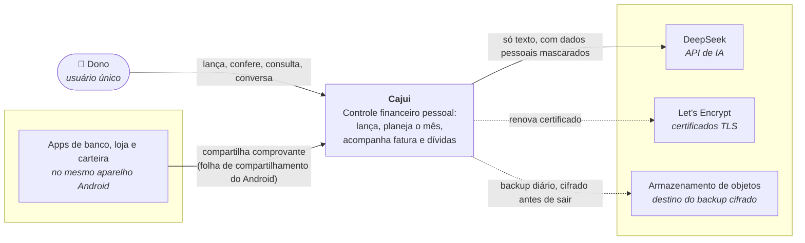
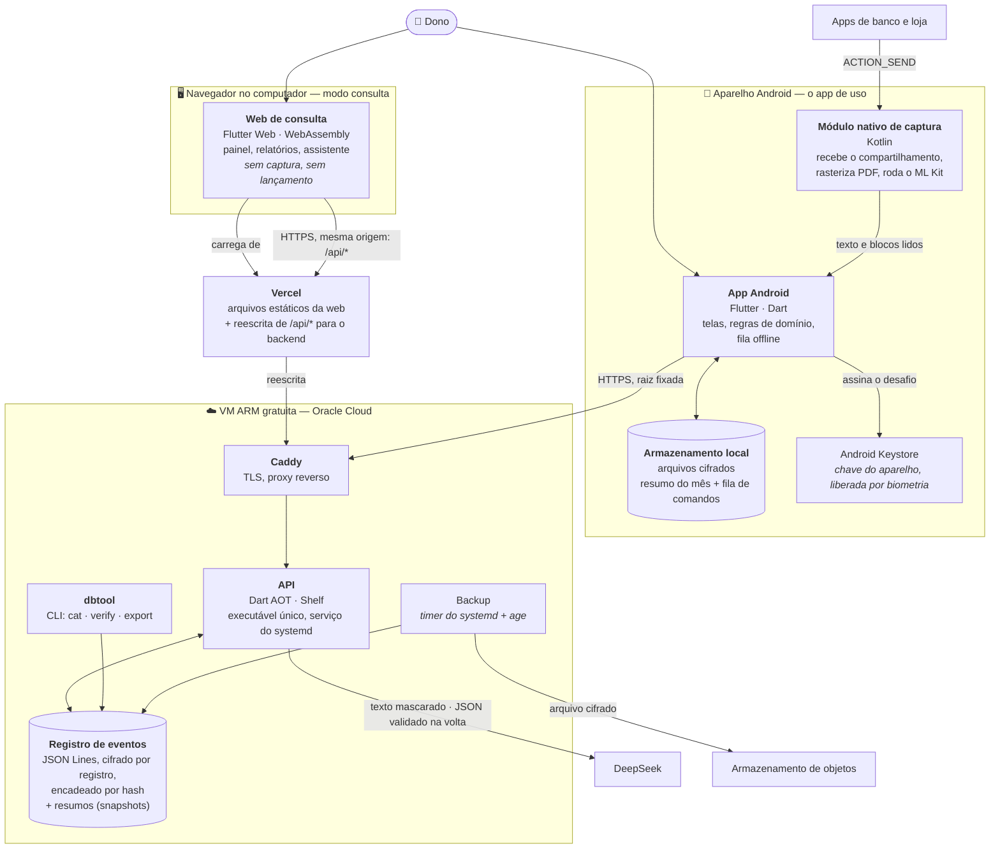

# Visão de arquitetura — C4

Dois níveis do modelo C4: o **contexto** (o Cajui e o mundo em volta) e os **contêineres** (as partes que rodam, e como conversam). O nível de componentes fica no código: cada feature segue a mesma forma, descrita em [Mapa de módulos](#mapa-de-módulos).

## Nível 1 — Contexto

Um sistema, uma pessoa. O Cajui não tem cadastro, não tem multiusuário e não fala com banco nenhum: o que entra, entra pelas mãos do dono — digitando ou compartilhando um comprovante.



O que **não** existe, de propósito: integração com banco ou Open Finance, leitura de notificação ou de SMS, envio de imagem para fora do aparelho, e qualquer terceiro que receba dado financeiro identificável.

## Nível 2 — Contêineres



### Quem faz o quê

| Contêiner | Responsabilidade | Não faz |
|---|---|---|
| App Android | Tudo o que o dono usa no dia a dia. Roda as regras de domínio localmente, para o painel abrir e o lançamento salvar sem rede | Não guarda a chave da IA; não fala com a DeepSeek |
| Módulo nativo de captura | Copia o arquivo compartilhado para a área privada, rasteriza PDF e lê o texto no aparelho | Não envia nada para fora; a imagem morre no aparelho |
| Armazenamento local | Última cópia dos resumos e a fila de comandos ainda não enviados, cifrados com chave do Keystore | Não é a fonte da verdade |
| Web de consulta | Ver e conversar, no computador | Não lança, não captura, não guarda sessão em disco |
| Vercel | Servir a web e fazer a API parecer da mesma origem, para o cookie de sessão ser de primeira parte | Não executa código do Cajui |
| Caddy | Certificado, HTTPS, cabeçalhos de segurança | Não conhece regra de negócio |
| API | Fonte da verdade: valida comandos com o mesmo domínio do app, grava eventos, monta resumos, fala com a IA | Não recebe imagem; não registra dado financeiro em log |
| Registro de eventos | A história inteira, só para acrescentar | Não é editado: correção é evento novo |
| `dbtool` | Ler, conferir e exportar o registro cifrado por SSH; cadastrar aparelho | Não roda como serviço |

### As três fronteiras de confiança

1. **Aparelho ↔ internet.** Só sai texto. O que veio do OCR é tratado como **dado não confiável**, no app e de novo na API.
2. **API ↔ DeepSeek.** Sai texto mascarado, dentro de um bloco delimitado como dado; volta JSON, que só é aceito se passar no esquema e se a categoria estiver na lista enviada.
3. **VM ↔ backup.** O arquivo é cifrado antes de sair, com uma chave pública cuja metade privada **não está no servidor**.

## Mapa de módulos

```
app/                       Flutter — Android e web de consulta
  lib/features/<feature>/
    application/           casos de uso; orquestram o domínio e as portas
    infrastructure/        adaptadores: HTTP, armazenamento local, canal nativo
    presentation/          telas e Notifiers (o ViewModel) — só aqui existe Flutter
server/                    Dart + Shelf
  lib/features/<feature>/
    application/           os mesmos casos de uso, do lado que grava
    infrastructure/        registro de eventos, DeepSeek, relógio
    presentation/          rotas HTTP e tradução de falha em resposta
packages/
  domain/                  Dart puro: entidades, objetos de valor, regras RN-xxx
  api_contract/            DTOs, esquemas e o enum de códigos de erro
  design_system/           tokens, componentes e a gallery
tool/                      verificadores do próprio projeto
spikes/                    código de medição, fora do workspace
```

A regra de dependência, de fora para dentro: `presentation → application → domain`, e `infrastructure → application → domain`. **`domain` não importa nada** — nem Flutter, nem `dart:io`, nem pacote de terceiros além de utilitários puros. É isso que deixa a mesma regra rodar no aparelho e no servidor ([ADR-001](adr/ADR-001-monorepo-e-dominio-compartilhado.md)).

Features: `ledger` (lançamentos) · `budget` (plano do mês e limites) · `income` · `payment_methods` (cartões e fatura derivada) · `debts` · `receipts` (captura) · `insights` (resumos) · `assistant` · `auth` · `settings`.
