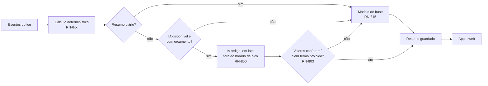

# Retorno periódico

Três ritmos — diário, semanal e mensal — e os lembretes de vencimento. As regras estão em [rules/feedback.md](rules/feedback.md) (RN-8xx); este documento mostra cada resumo escrito de verdade, com os números do [exemplo de setembro de 2026](rules/indicators.md#exemplo-completo) e a história das [jornadas](journeys.md).

## O pedido e a literatura

O pedido original inclui retorno **diário**. A literatura lida na Fase 1 recomenda cautela: retorno frequente demais leva a foco excessivo no dado mais recente (Lurie2009), notificação em excesso está associada a emoções negativas (Pielot2014), e não há evidência de que um ritmo seja melhor que outro em finanças pessoais (D-UX-17).

A saída adotada separa **existir** de **interromper**:

| Ritmo | Existe dentro do app | Notifica por padrão |
|---|---|---|
| Diário | Sempre, atualizado a cada lançamento | **Não** — pode ser ligado (RN-813) ⚑ validar |
| Semanal | Sempre | Sim, canal silencioso, domingo às 20h (RN-823) |
| Mensal | Sempre | Sim, canal silencioso, a partir do dia 1 (RN-830) |
| Vencimentos | — | Sim: dois dias antes e no dia (RN-840) |

Todos em canal de baixa prioridade, sem som nem vibração; cada um com chave, dia e horário próprios (RN-847).

## Como cada resumo é produzido

A IA nunca faz conta (RN-801): recebe os números prontos e só escolhe as palavras. Se ela falhar em qualquer ponto, o modelo de frase entrega o mesmo resumo (RN-802).

## Diário

**Sábado, 19 de setembro.** Semana de 14 a 20/09, limite de R$ 226,47. Até sexta, R$ 73,10 de variável em dinheiro; hoje, mercado R$ 38,40 e ônibus R$ 8,50, os dois no Pix — o vale acabou no dia 12.

> **Hoje: R$ 46,90 em 2 lançamentos.**
> Sobram R$ 106,47 até domingo.

| Conta | Resultado |
|---|---|
| Gasto da semana: 73,10 + 46,90 | 120,00 |
| Resta na semana (RN-642): 226,47 − 120,00 | **106,47** |

Variações do mesmo dia:

| Situação | Texto |
|---|---|
| Com compra no vale | "Hoje: R$ 8,50 em dinheiro e R$ 38,40 no vale, em 2 lançamentos. Sobram R$ 144,87 até domingo." — o vale não entra no limite (RN-643) e não é somado (RN-804) |
| Com o fogão parcelado lançado hoje | "… Sobram R$ 106,47 até domingo. Fogão em 6× de R$ 160,00: a primeira parcela entra em outubro." — parcelamento não consome o limite (RN-312) |
| Com gasto acima do costume | "Mercado de R$ 320,00 hoje — o dobro do seu costume. Foi compra do mês?" `Marcar como fora do padrão` (RN-814) |
| Sem lançamento | "Nada lançado hoje." |
| Com captura pendente | "Nada lançado hoje. 2 comprovantes esperando sua conferência." |
| Semana já acima do limite | "Hoje: R$ 46,90 em 2 lançamentos. A semana passou R$ 12,30 do limite; a próxima já considera isso." |

Notificação, se ligada: `Hoje: R$ 46,90 em 2 lançamentos. Sobram R$ 106,47 até domingo.` Com a semana acima do limite, a tela bloqueada mostra só `Resumo do dia pronto.` (RN-843).

## Semanal

### Semana que passou do limite

**Domingo, 13 de setembro, 20h.** Semana de 7 a 13/09.

> **Semana de 7 a 13 de set.: R$ 260,00 de R$ 236,25.**
> Passou R$ 23,75 do limite. A próxima já considera isso: **R$ 226,47 até domingo, 20.**
>
> O excesso se diluiu nos 17 dias que restam: o limite ficou R$ 9,78 menor do que seria.
>
> **Vale:** R$ 0,00 desde sábado. O mercado passa a sair do dinheiro até o crédito de outubro.
> **Vence nos próximos 7 dias:** empréstimo, parcela 5 de 12, R$ 212,00, terça, 15.
>
> `Ver a conta` · `Ver os lançamentos da semana`

| Conta | Resultado |
|---|---|
| Restante do variável: 980,00 − 170,00 − 260,00 | 550,00 |
| Limite seguinte (RN-641): ⌊550,00 × 7 ÷ 17⌋ | **226,47** |
| Limite se a semana tivesse ficado no limite: ⌊573,75 × 7 ÷ 17⌋ | 236,25 |
| Quanto o excesso custou por semana: 236,25 − 226,47 | **9,78** |

"Ver a conta" abre exatamente essa tabela, em palavras: "Restam R$ 550,00 de variável para 17 dias; 7 deles são da próxima semana."

Notificação: `Resumo da semana pronto. Limite da próxima: R$ 226,47.` — o valor de quanto passou não aparece na tela bloqueada (RN-843).

### Semana dentro do limite

**Domingo, 20 de setembro.**

> **Semana de 14 a 20 de set.: R$ 200,00 de R$ 226,47.**
> Ficou R$ 26,47 abaixo do limite, e isso já passou para a frente: **R$ 245,00 até domingo, 27.**
>
> **Vence nos próximos 7 dias:** nada.

| Conta | Resultado |
|---|---|
| Restante: 550,00 − 200,00 | 350,00 |
| Limite seguinte: ⌊350,00 × 7 ÷ 10⌋ | **245,00** |

Nenhum "parabéns", nenhuma medalha (RN-806). Se for o caso: "Foi a segunda semana seguida dentro do limite."

### Semana sem lançamentos

> **Semana de 14 a 20 de set.: R$ 41,00 de R$ 226,47.**
> Nenhum lançamento de quarta a sexta. Se faltou algum, dá para lançar agora com a data certa. (RN-824)

## Mensal

### Mês que fecha com sobra

**Quinta, 1º de outubro.** Aviso: `Setembro está pronto para fechar. Leva 2 minutos para conferir.`

> ## Como foi setembro
>
> **Cumprido:** 4 fixos pagos · parcela 5 de 12 do empréstimo · parcela 3 de 10 da geladeira · 4 de 5 variáveis dentro do previsto · 4 de 5 semanas dentro do limite.
>
> **Setembro fechou com R$ 598,00 de sobra** — R$ 40,00 acima do plano.
>
> | Bloco | Plano | Realizado |
> |---|---|---|
> | Fixos | 1.300,00 | 1.300,00 |
> | Variáveis, em dinheiro | 980,00 | 940,00 |
> | Dívidas | 362,00 | 362,00 |
>
> **Lazer passou R$ 60,00 do previsto** (R$ 310,00 de R$ 250,00). Os outros quatro variáveis ficaram R$ 100,00 abaixo, somados.
> **Fora do padrão no mês:** nada.
> **Vale:** R$ 650,00 usados, tudo em mercado. Saldo para outubro: R$ 0,00.
> **Custo de vida:** R$ 86,73 por dia em dinheiro · R$ 21,67 por dia no vale.
>
> **Mudou em relação a agosto:** lazer + R$ 70,00 (de 240 para 310) · transporte − R$ 42,00 (de 260 para 218).
>
> ## Como fica adiante
>
> **Empréstimo:** faltam 7 parcelas de R$ 212,00. No ritmo atual, quita em abril de 2027.
> **Geladeira:** faltam 7 parcelas de R$ 150,00 · ainda comprometido R$ 1.050,00.
> **Fogão:** parcela 1 de 6 em outubro · R$ 160,00 · ainda comprometido R$ 960,00.
> **Outubro no plano:** sobram R$ 348,00. O vale começa em R$ 600,00, e R$ 200,00 do mercado saem do dinheiro.
>
> **Para outubro:**
> 1. Rever a faixa de lazer: R$ 310,00 em setembro contra um máximo de R$ 250,00.
> 2. Reservar R$ 146,00 por mês para gastos fora do padrão, a média dos últimos 12 meses.
>
> `Fechar setembro`

| Conta | Resultado |
|---|---|
| Resultado realizado (RN-623): 3.200 − 1.300 − 362 − 940 | **598,00** |
| Variáveis: 150 + 218 + 310 + 104 + 158 | 940,00 |
| Custo por dia em dinheiro (RN-651): 2.602 ÷ 30 | **86,73** |
| Outubro (RN-620): 3.200 − 1.300 − 522 − 1.030 | **348,00** |

A sobra de setembro não vira orçamento extra de outubro (RN-422).

### Mês que fecha com falta

O cenário do conserto de R$ 700,00 no dia 3 (jornada F), **sem** que os ajustes tenham sido aplicados.

> ## Como foi setembro
>
> **Cumprido:** 4 fixos pagos · parcela 5 de 12 do empréstimo · parcela 3 de 10 da geladeira · 4 de 5 variáveis dentro do previsto.
>
> **Setembro fechou com falta de R$ 102,00.**
>
> **Fora do padrão no mês:** conserto do celular, R$ 700,00. Foi o que tirou o mês do plano: sem ele, a sobra seria de R$ 598,00.
>
> ## Como fica adiante
>
> Nada é descontado de outubro por conta própria. **Outubro no plano: sobram R$ 348,00** — é de onde os R$ 102,00 podem ser recompostos, se você quiser.
>
> **Para outubro:**
> 1. Recompor os R$ 102,00 com a sobra prevista de outubro.
> 2. Reservar R$ 146,00 por mês para gastos fora do padrão.

| Conta | Resultado |
|---|---|
| Resultado realizado: 598,00 − 700,00 | **falta de 102,00** |

A falta realizada (R$ 102) é menor que a projetada no dia 3 (R$ 142) porque os variáveis fecharam R$ 40 abaixo do pior caso. Nenhuma frase diz "você gastou demais"; o conserto é descrito como o fato que foi (RN-805, RN-837).

## Lembretes de vencimento

| Situação | Texto na tela | Tela bloqueada |
|---|---|---|
| Fixo, dois dias antes, mês com sobra | "Aluguel de R$ 1.100,00 vence quinta, 10. Pelo que está lançado, o mês continua com sobra de R$ 558,00." | Igual |
| Fatura, mês com sobra | "Fatura do cartão final 4821: R$ 640,00, vence segunda, 5. Esse valor já está contado em setembro; é a reserva da fatura." | Igual |
| Parcela, mês com falta | "Parcela 5 de 12 do empréstimo, R$ 212,00, vence terça, 15. Pelo que está lançado, faltam R$ 142,00 para fechar setembro. `Ver os ajustes`" | "Parcela do empréstimo vence terça, 15." |
| No dia | "O aluguel vence hoje." | Igual |

Todo valor de "sobra depois de pagar" é **estimativa**: o app não conhece o saldo da conta, só o que foi lançado, e diz isso ("pelo que está lançado") (RN-841). O motivo é medido: no Brasil, lembrete de fatura sem contexto reduziu multa por atraso e **aumentou** tarifa de cheque especial (Medina2021).

## Relatório simplificado e detalhado

| | Simplificado | Detalhado |
|---|---|---|
| Diário | Os dois números | — (RN-863) |
| Semanal | Limite, gasto, limite seguinte | + lançamentos da semana, categorias que passaram do máximo, vencimentos |
| Mensal | Resultado, três blocos, vale, sugestões | + categorias, comparação com o mês anterior, fora do padrão, custo por dia, lançamentos |

Na preferência **mais visual**, o fechamento abre com uma barra empilhada — fixos, variáveis e dívidas sobre a renda em dinheiro — e o vale em barra separada; cada segmento tem o valor escrito. Na **mais numérica**, a mesma informação vem em tabela. Trocar de nível ou de forma nunca muda um número (RN-860 a RN-862).
