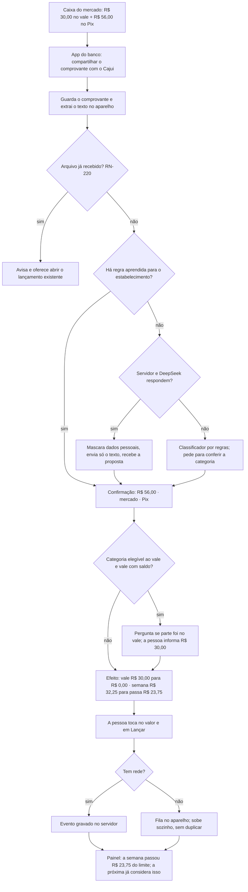
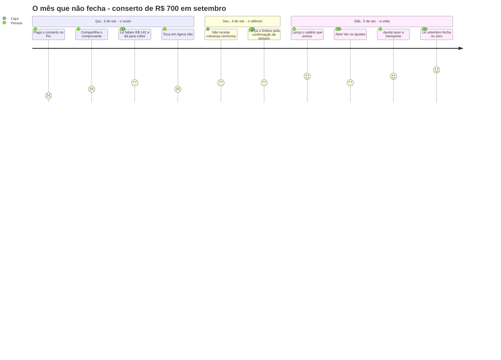

# Personas e jornadas

O Cajui tem **um usuário real**. Este documento não monta elenco de personas: descreve essa pessoa com precisão suficiente para decidir tela, os dois modos em que ela usa o app, para quem o app **não** é e o mapa das jornadas. As nove jornadas, passo a passo, estão em [journeys.md](journeys.md).

Termos em [glossary.md](glossary.md); regras em [rules/](rules/README.md); decisões `D-UX-NN` em [ux-financial-literature.md](../research/ux-financial-literature.md). Os números são os do [exemplo de setembro de 2026](rules/indicators.md#exemplo-completo). Texto de tela, entre aspas, segue o [guia de voz](../brand/voice-and-tone.md). Este arquivo não define regra de negócio: o que as jornadas revelaram e ainda não tem regra está em [Questões abertas](#questões-abertas).

## A persona primária: quem cuida do orçamento do domicílio

### Retrato

Adulto jovem, mora de aluguel, renda apertada. O domicílio tem duas rendas em dinheiro e um vale alimentação; quem opera o orçamento é uma pessoa só. Mantém há tempo uma planilha com lógica própria — duas moedas, três blocos, variável pelo pior caso ([problem.md](problem.md)) — e tem a disciplina de alimentá-la. Não precisa aprender a orçar: precisa parar de digitar, parar de ser enganada pela linha "fatura do cartão" e ser avisada em vez de descobrir.

| Traço | Como é | O que exige do app |
|---|---|---|
| Aparelhos | Celular Android sempre à mão; computador em casa | O Android captura e confirma; a web só consulta |
| Pagamentos | Pix, débito, um cartão de crédito (final 4821, fecha dia 25, vence dia 5) e o cartão do vale | O comprovante do app do banco é a porta de entrada do lançamento |
| Relação com número | Só confia em conta que consegue refazer | Cálculo determinístico e explicável (RN-601, RN-602, D-UX-23) |
| Relação com o aperto | Sabe que o mês é justo e evita olhar quando espera notícia ruim | O painel abre no que ainda dá para fazer (RN-670, D-UX-01, D-UX-22) |
| Tempo | Registra na rua, em pé, com pressa; analisa sentada, no fim de semana | Confirmação em uma tela no celular; leitura e conversa no computador |

### O domicílio em números

| Item | Valor | Regras |
|---|---|---|
| Renda em dinheiro | Salário R$ 2.400 (dia 5) + segunda renda R$ 800 (dia 20) = **R$ 3.200** | RN-130, RN-610 |
| Vale disponível | Saldo de R$ 50 + crédito de R$ 600 (dia 1) = **R$ 650**, nunca somado ao dinheiro | RN-111, RN-611 |
| Fixos | Aluguel 1.100 · internet 100 · streaming 40 · celular 60 = **R$ 1.300** | RN-410 |
| Dívidas | Empréstimo de 12 parcelas de R$ 212 (dia 15) + geladeira em 10× de R$ 150 no cartão = **R$ 362** no mês | RN-501, RN-504 |
| Variáveis | Mercado 500–800 (elegível ao vale) · transporte 180–260 · lazer 100–250 · farmácia 50–150 · luz 110–170; pior caso em dinheiro **R$ 980** | RN-421, RN-425 |
| Plano do mês | **Sobram R$ 558** · 52% da renda comprometida · R$ 88,07 por dia em dinheiro e R$ 21,67 em vale | RN-620, RN-630, RN-650 |

A margem é de R$ 558 num mês em que tudo corre pelo pior caso. Um conserto de R$ 700 basta para o mesmo setembro virar "faltam R$ 142". Essa é a distância entre os [dois modos](#dois-modos-da-mesma-pessoa).

### Objetivos

1. Saber, a qualquer hora, **quanto ainda cabe na semana**, sem abrir planilha nem fazer conta.
2. Lançar **sem digitar**: compartilhar o comprovante, conferir uma tela, tocar em "Lançar".
3. Ver o cartão como ele é: o que foi comprado, no mês em que foi comprado; fatura conferida em minutos, sem linha de "fatura" em lugar nenhum.
4. Ver cada dívida andando até o fim, com o total ainda comprometido à vista.
5. Entender o mês no computador e poder perguntar "por quê?" a quem mostra a conta.
6. Ser avisada — no ritmo que escolheu, sem bronca.

### Frustrações com a planilha

| Frustração | Como aparece hoje | Resposta do Cajui |
|---|---|---|
| Digitar todo gasto | É o que falha primeiro no mês corrido, que costuma ser o apertado | Compartilhamento com OCR local e proposta ([sharing-flow.md](sharing-flow.md)) |
| "Fatura do cartão" como linha | Esconde o que foi comprado, conta em dobro ou perde a categoria, joga o gasto para o mês seguinte | Cartão é forma de pagamento; fatura é visão derivada (RN-301, RN-310, RN-330) |
| Parcelado invisível | A planilha mostra a parcela do mês, não o que ainda está comprometido | Total comprometido sempre ao lado da parcela (RN-313) |
| Vale somado ao dinheiro | O "total" da planilha é um número que não existe | Duas moedas, nunca somadas (RN-111, RN-114) |
| Silêncio | A planilha só fala com quem abre; no aperto, ninguém abre | Retorno semanal e mensal ([feedback.md](feedback.md)) |
| Número sem explicação | Fórmula quebrada passa despercebida por meses | Todo número é recalculável e o assistente diz de onde veio (RN-601, D-UX-23) |
| Longe do gasto | A planilha vive no computador; o gasto acontece na rua | O lançamento nasce no celular, na hora |

### O que seria sucesso

1. **Primeiro uso em menos de 10 minutos**, terminando em números que batem com a planilha: sobram R$ 558, 52% comprometido (jornada A). O tempo se confirma em teste com a planilha real.
2. **Planilha aposentada**: dois fechamentos seguidos feitos só no Cajui. ⚑ validar
3. Lançar por compartilhamento custa **menos que digitar a linha**: uma tela e, com confiança alta, nenhum campo digitado. O tempo-alvo é requisito não-funcional e se confirma no spike da Fase 4.
4. Fatura conferida até "R$ 0 ainda não identificados", sem nunca ter existido um lançamento "fatura" (RN-207, RN-332).
5. **No mês apertado a pessoa continua lançando.** É o critério que mais importa e o mais difícil; a medida proposta é o contador de uso do próprio aparelho, comparando meses com sobra e com falta. ⚑ validar
6. A quitação do empréstimo, em abril de 2027 no ritmo atual, acontece dentro do app e vira marco (RN-530).
7. Custo fixo de R$ 0 por mês, com o consumo de tokens visível.

### O que faria a pessoa desistir

A literatura de evitação diz quando se para de olhar: a atenção às finanças **cai** quando o saldo vira negativo e cai mais conforme a dívida cresce (Olafsson2025); vergonha financeira leva a afastamento, que piora as decisões, em ciclo (Gladstone2021); informação ruim é evitada mesmo quando é útil e gratuita (Golman2017). Cada gatilho abaixo tem uma defesa já especificada.

| Gatilho de abandono | Defesa |
|---|---|
| Abrir e levar um susto: número negativo grande, vermelho, no topo | O painel abre no resta na semana; falta e comprometimento no segundo nível; barro em vez de vermelho, com sinal, rótulo e ícone (RN-670, RN-671, D-UX-01, D-UX-02) |
| Texto que atribui falha, ou festa exagerada na sobra | Guia de voz; nenhuma mensagem atribui falha à pessoa (RN-542, D-UX-22) |
| Notificação que cobra, ou valor negativo na tela bloqueada | Sem notificação diária por padrão; um aviso por evento; nada recorrente enquanto o mês está com falta (D-UX-19, D-UX-21) |
| Lembrete de fatura que só manda pagar | Todo lembrete de vencimento leva contexto de caixa (D-UX-20, Medina2021) |
| Confirmar dá mais trabalho que digitar; pergunta demais | Três zonas de confiança; três posições de autonomia em Configurações (D-UX-06, D-UX-10) |
| Categoria errada gravada em silêncio, descoberta semanas depois | Nada é gravado sem passar diante da pessoa; corrigir custa dois toques (D-UX-07, D-UX-09) |
| Número que não bate com a conta de cabeça | Cálculo puro sobre o log; a IA nunca calcula (RN-601, RN-602) |
| Lançamento perdido por falta de rede | Comprovante salvo no aparelho na hora; fila com idempotência ([data-model.md](data-model.md)) |
| Voltar depois de dias sem lançar parece castigo | Sem sequência punitiva; lançamento tardio é aceito e só recalcula (RN-252, RN-646, D-UX-22) |
| Dívida como manchete | A tela de dívidas nunca é a de entrada; o total fica no rodapé (RN-540, RN-541) |

## Dois modos da mesma pessoa

O modo **não é configuração nem estado gravado**: é leitura dos indicadores (RN-601), e a pessoa nunca é informada de que "entrou" num modo. A estrutura da tela é a mesma nos dois; mudam o segundo nível, o ritmo dos avisos e o que o app oferece. O paradoxo que organiza o desenho: **é no mês apertado que o app mais precisa ser aberto, e é quando a pessoa menos quer abrir.**

| | Mês tranquilo | Mês apertado |
|---|---|---|
| Como o app reconhece | Resultado projetado ≥ 0 (RN-621, RN-622) | Resultado projetado < 0, variável do mês esgotado (RN-645), ou fixo ou parcela em aberto (RN-414, RN-524) |
| Exemplo | Setembro do plano: sobram R$ 558 | Setembro com o conserto de R$ 700 no dia 3: faltam R$ 142 |
| O que a pessoa sente | Curiosidade; quer confirmar que está tudo no lugar | Aperto e vergonha antecipada; prefere não saber o tamanho |
| Quando abre | Mais vezes, sobretudo quando a renda entra | Menos; e o lançamento é o primeiro hábito a cair |
| Porta de entrada | Painel e resumo semanal | A **confirmação do compartilhamento**: é a tela que a pessoa vê mesmo sem querer "abrir o app" |
| Painel, primeiro nível | "Sobram R$ 412 até domingo" (RN-670) | O mesmo número, no mesmo lugar; com o variável esgotado, vale RN-645 |
| Painel, segundo nível | "Sobram R$ 558 no mês" e o comprometimento | "Faltam R$ 142 para fechar setembro. Dá para cobrir sem mexer nos fixos." e o botão "Ver os ajustes" (RN-662) |
| Confirmação do lançamento | Mostra o efeito na semana (D-UX-05) | Igual; a falta do mês nunca é a manchete da confirmação |
| Avisos | Resumo semanal, vencimentos, fechamento, em canal silencioso (D-UX-19) | Um aviso por evento, sem valor negativo na tela bloqueada; o retorno é ancorado em momento favorável — renda lançada, vale creditado (D-UX-21) |
| Lembrete de vencimento | Valor, data e quanto sobra depois de pagar | Diz que pagar deixa o mês com falta e aponta para a tela de dívidas (D-UX-20) |
| Assistente | Explica e compara períodos | Simula ajustes e mostra a conta; não moraliza categoria (RN-533, D-UX-23) |
| Fechamento | "Setembro fechou com R$ 598 de sobra.", tom contido | Começa pelo que foi cumprido; a falta é valor a recompor e não vira dívida automática (D-UX-13, RN-443) |
| Som, se ligado | Quitação é marco sonoro (D-UX-14) | Aviso é nota grave e macia, nunca buzina |
| Nunca | Festa, exclamação, "parabéns" | Vermelho, bronca, contagem de dias sem lançar, total das dívidas em destaque |

Consequência de projeto: no mês apertado, a **confirmação do compartilhamento é a tela mais vista do app**. Ela carrega o número prospectivo — quanto resta na semana depois deste lançamento — e nunca a falta do mês.

## Anti-persona: para quem o Cajui não é

Cada linha corresponde a um item de "Fora do escopo" em [problem.md](problem.md). Pedido que venha destas expectativas é recusado na origem, não adiado.

| Quem | O que espera | Por que não | Item de problem.md |
|---|---|---|---|
| Quem quer tudo automático | Conexão com banco, Open Finance, leitura de notificação ou SMS, importação de extrato, saldo da conta em tempo real | Os dados entram por compartilhamento ou digitação. O app não conhece o saldo da conta: trabalha com orçamento, e o que depende de caixa é estimativa declarada | Sem integração bancária |
| O investidor | Carteira, rentabilidade, metas de patrimônio, "onde aplico a sobra?" | O assistente explica e simula o próprio orçamento; não recomenda produto financeiro | Sem investimentos |
| O casal ou a república com contas separadas | Convites, papéis, divisão de despesas entre pessoas, "quem deve a quem" | O domicílio pode ter várias rendas, mas quem opera é uma pessoa, com um aparelho pareado | Um usuário só |
| Quem vive no computador | Lançar pelo navegador, enviar foto pelo desktop, editar em massa como na planilha | A web é modo consulta: painel, relatórios e conversa | Sem captura na web |
| Quem recebe ou gasta em outra moeda | Câmbio, conta no exterior, viagem em dólar | Só real. "Duas moedas" é dinheiro e vale | Uma moeda corrente |
| Quem quer ser cobrado | Metas com medalha, sequência de dias, ranking, alerta a cada gasto | O app descreve e não julga; sem sequência punitiva (D-UX-22) e sem notificação diária por padrão (D-UX-19) | — (postura de produto) |

## Mapa das jornadas

| | Jornada | Quando, no exemplo | Onde | Regras centrais |
|---|---|---|---|---|
| A | Primeiro uso: sair da planilha | seg., 31 de ago. | Android | RN-130, RN-410, RN-420, RN-302, RN-501 |
| B | Mercado pago parte no vale, parte no Pix | sáb., 12 de set. | Android | RN-122, RN-203, RN-204, RN-425, RN-643 |
| C | Compra parcelada no cartão | sáb., 19 de set. | Android | RN-311, RN-312, RN-313, RN-503 |
| D | A fatura chega: conferir, achar o que falta, pagar | sáb., 26 de set. e seg., 5 de out. | Android | RN-330 a RN-332, RN-320, RN-340 a RN-343 |
| E | Domingo à noite: o resumo semanal | dom., 13 de set. | Android | RN-641, RN-642, RN-646 |
| F | O mês que não fecha: do aviso ao plano de ajuste | qui., 3 a sáb., 5 de set. (cenário do conserto) | Android | RN-424, RN-621, RN-660 a RN-663 |
| G | A virada do mês e o fechamento | qui., 1º de out. | Android | RN-431, RN-440 a RN-443, RN-644 |
| H | No computador: entender o mês e conversar | qui., 17 de set. | Web | RN-602, RN-630, RN-533 |
| I | O app pergunta, e a resposta vira regra | sex., 18 de set. | Android | D-UX-06 a D-UX-09 |

As jornadas A a E e G a I compõem um único setembro coerente com a tabela de limites semanais do exemplo. A jornada F usa o cenário alternativo do mesmo exemplo (o conserto de R$ 700 no dia 3).

## As duas jornadas que mais importam

**B** é o gesto que substitui a digitação e acontece várias vezes por semana. **F** é o momento em que a pessoa decide se continua abrindo o app.

### B — do caixa do mercado ao painel

### F — a curva de quem leva o susto e volta

A nota de cada passo (1 a 5) é a disposição esperada da pessoa. O desenho existe para que ela não fique no 1.

## Questões abertas

Pontos que as jornadas revelaram e que nenhuma regra cobre ainda. Valem como proposta até o checkpoint da Fase 2. ⚑ validar

| # | Questão | Proposta | Jornada |
|---|---|---|---|
| Q1 | O primeiro uso traz o histórico da planilha? | Não. O Cajui começa no mês corrente; o saldo do vale informado entra como ajuste (RN-123) com motivo "saldo inicial" | A |
| Q2 | Parcelamento no cartão anterior ao app | Cadastro manual como dívida `cardInstallment` sem lançamento de origem; precisa apontar para o cartão para compor a fatura (RN-330), campo que `Debt` ainda não tem | A, D |
| Q3 | A primeira fatura depois da adoção traz compras anteriores ao início do uso | Informar uma vez, por cartão, o "valor anterior ao Cajui" daquela fatura: explica a diferença sem virar despesa nem ajuste (RN-332) | D |
| Q4 | O comprovante do Pix cobre só parte da compra dividida com o vale | Em categoria elegível, com saldo de vale maior que zero, a confirmação pergunta se parte foi no vale | B |
| Q5 | Gasto fora do plano consome o limite semanal inteiro (RN-424 com RN-643): o conserto de R$ 700 faria o painel abrir em "a semana passou R$ 504 do limite" e levaria o limite seguinte a R$ 81,66, abaixo do mínimo das faixas, embora o ajuste necessário seja R$ 142 | Decidir se lançamento sem faixa ou fora do padrão fica fora do gasto da semana e conta só no resultado projetado | F |
| Q6 | Com aviso recorrente pausado no mês com falta (D-UX-21), o que traz a pessoa de volta? | O resumo continua dentro do app; a volta vem pela confirmação do compartilhamento e por aviso ancorado em renda lançada ou vale creditado | E, F |
| Q7 | A web corrige categoria? | Não na primeira versão: mostra o lançamento e indica o celular | H |
| Q8 | Estabelecimento ambíguo (posto, farmácia que vende lanche) | Na segunda correção da mesma regra aprendida, oferecer "perguntar sempre para este lugar" | I |
| Q9 | Semana partida pela virada do mês (RN-644) | O texto do painel troca "até domingo" por "até quarta, 30 de set." | G |
| Q10 | Pergunta de esclarecimento adiada ("Responder depois") | A proposta pendente não entra em indicador e aparece no resumo semanal | E, I |

Termos usados aqui que ainda não estão no glossário: **mês tranquilo** e **mês apertado** (só na especificação, nunca na tela), **primeiro uso**, **plano de ajuste**, **lançamento tardio** e **em aberto** (os dois últimos já aparecem em RN-252 e RN-414).
