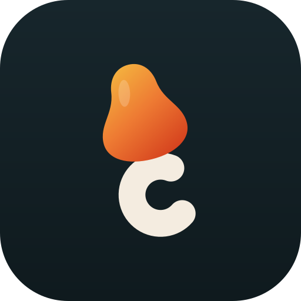
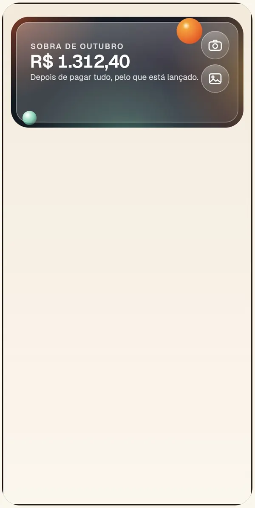
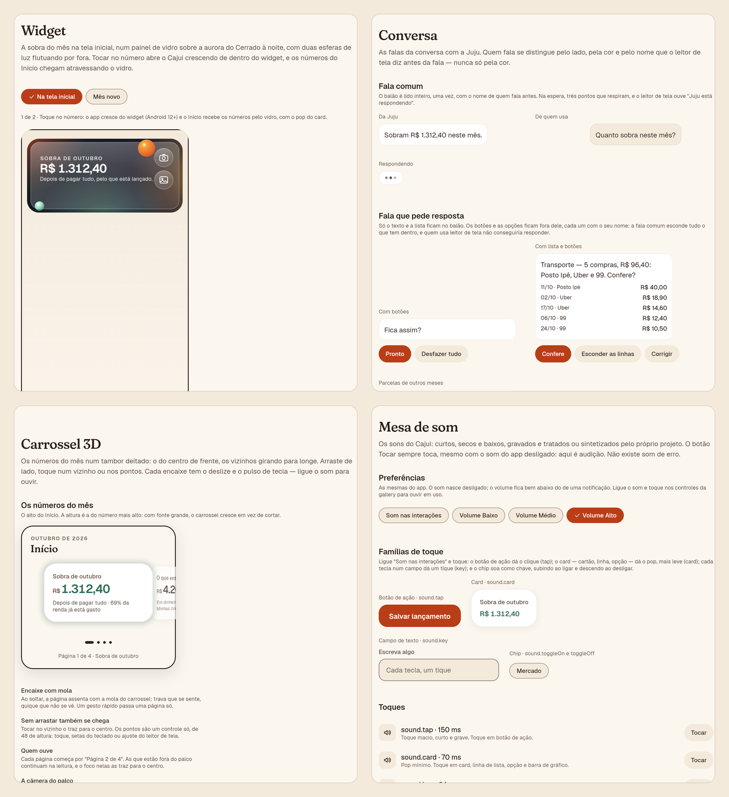

<div align="center">

<sub>[Português](README.md) · **English**</sub>



# Cajui · Design system

**The single source of everything Cajui draws, plays and moves.**

Tokens, components, 3D motion, sound and accessibility in a Flutter package of its own, with a browsable gallery that
shows every component, every screen state and every decision. The app never writes a color, a text style or a duration
by hand: it asks the design system, and the pipeline fails anyone who tries.

<picture>
  <source media="(prefers-reduced-motion: reduce)" srcset="../../docs/media/design-system/widget.png" />
  
</picture>

<sub>The arrival from the widget, recorded in the gallery: the app grows out of the glass and the numbers come through
the veil.</sub>

**[See the gallery live](https://cajui-teal.vercel.app/gallery/)** · [Project README](../../README.en.md) ·
[Brand](../../docs/brand) · [Tokens](../../docs/design/tokens.md) · [Components](../../docs/design/components.md)

</div>

---

**For reviewers:** [In 30 seconds](#in-30-seconds) · [Visuals](#visuals) · [What's inside](#whats-inside) ·
[Decisions worth telling](#decisions-worth-telling) · [Quality](#quality)<br />
**For developers:** [Using it](#using-it) · [Running the gallery](#running-the-gallery) · [Structure](#structure)

## In 30 seconds

- **Single source:** changing the color of every primary button in the app means changing one token. A custom checker
  fails `Color(`, `TextStyle(` and Material inside the app.
- **Built for a money app:** amounts use tabular figures that line up in columns, the month's shortfall is shown in
  clay and never in alarm red, and cash and meal voucher stay apart, even in color.
- **Motion with a purpose:**
  - depth scrolling and a 3D carousel;
  - a cinematic entrance, a wallet stack and a camera move between screens;
  - the arrival from the widget, where the number comes through the glass.

  All of it in three levels (`full`, `lite`, `reduced`), and reduced motion is always honored.
- **Sound as a token:** each control family has its own sound, mastered for a phone speaker. Sound starts off.
- **Accessible by test:** every color pair in use has its WCAG contrast measured in both themes, every control has a
  minimum touch target and a name for the screen reader, and keyboard focus shows in a ring of its own.
- **A gallery that is a product:** a front door, the app's 7 screens in their 69 states side by side ([Estados das telas](https://cajui-teal.vercel.app/gallery/#/estados-das-telas)), the rules in pairs ([Faça e evite](https://cajui-teal.vercel.app/gallery/#/faca-e-evite)), a dark theme, sound and an address for every page.

## Visuals

<p align="center">
  
  <br /><sub>The gallery: the glass widget, the conversation, the 3D carousel and the sound desk.</sub>
</p>

## What's inside

| Layer | What it is |
| --- | --- |
| **Tokens** | A raw palette (not exported) and semantic roles: surface, text, action, border, intent, data and brand. Spacing, radius, shadow, depth, duration, curve and spring |
| **Typography** | Fraunces for the voice (titles and the headline number) and Geist for data, with tabular figures |
| **Components** | Button, chip, switch, fields, card, list row, meter, rolling amount, chat message, notice, skeleton, month-by-month chart, 3D credit card, wallet, carousel, base screen and the glass (aurora, panel and orb) |
| **Motion** | Cinematic entrance, camera between screens, depth scrolling, a number that counts and flies, tilt, the arrival through the glass and the monitor that lowers the level when the device drops frames |
| **Sound** | Tokens by meaning (`tap`, `card`, `key`, `saved`, `notice`…), three families switched on separately and up to 3% speed variation, so the same sound never plays twice in a row exactly alike |
| **Icons** | Drawn in code, all with the same 1.75 stroke and round caps |

## Decisions worth telling

### Glass that blurs nothing

The home screen widget is glass over an aurora, but Android won't let a widget blur the wallpaper. Instead of faking
it, the design system draws the way the device draws: the aurora (`CajuiAurora`) is only diffuse light, with no edges,
and the glass (`CajuiGlassPanel`) is just a translucent veil with a rim of light. It looks frosted because what is
behind it has no edges anymore. The gallery replica and the app's `home_widget.xml` share the same values.

### Sound you can hear on a phone

The touch sounds came from recordings the owner picked, and on the device they almost vanished. A phone speaker barely
plays below 300–400 Hz, and the button click had 99% of its energy between 150 and 300 Hz.
[`level_sounds.py`](../../tool/sound/level_sounds.py) masters each file for the speaker:

1. it creates harmonics from the lows, and the ear rebuilds the note;
2. it cuts the sub-bass;
3. it gently saturates up to the family's target, measured the way the phone plays it (ITU-R BS.1770 K-weighting,
   nothing below 400 Hz).

When saturation made the click harsh, the button got a softer recording, and its target went up with less
saturation. A test fails any sound that drops back out of reach.

### A shortfall without alarm

The month's shortfall shows in clay, not red. The side-by-side comparison lives in the gallery itself (the
[Cor da falta](https://cajui-teal.vercel.app/gallery/#/cor-da-falta) page), and red is kept for actual errors.

### Motion you can measure

Each effect states what it does at each level: `lite` drops the shader and the blur and keeps parallax simple;
`reduced` turns transitions into a 120 ms crossfade and shows the number still, at its final value. A frame monitor
lowers the level on its own if the device can't keep up.

## Quality

| Item | Status |
| --- | --- |
| Tests | **213** in the package and **35** in the gallery, including the contrast of every pair in both themes and the level of every sound |
| Coverage | 87.7% of lines, with a 75% floor in CI |
| Analyzer | `very_good_analysis`, zero warnings |
| Limits | 300 lines per file, 30 per function, one public type per file, checked on every commit |
| Origin | Every bundled file (sound, font) has its source and license in [`assets/CREDITS.md`](assets/CREDITS.md) |

---

## Using it

```dart
import 'package:design_system/design_system.dart';

CajuiTheme(
  data: CajuiThemeData.light(),
  child: CajuiFeedbackScope(
    feedback: const SilentFeedback(),
    child: CajuiButton(label: 'Lançar', onPressed: () {}),
  ),
);
```

Colors, text and measures always come from `CajuiTheme.of(context)` and from the tokens (`CajuiSpacing`,
`CajuiRadius`, `CajuiDurations`…). Components don't play sound: they tell `CajuiFeedback` what happened, and whoever
assembles the app decides whether there is sound, vibration or nothing.

## Running the gallery

```bash
cd packages/design_system/gallery
flutter run -d chrome
```

Or the production build, as Vercel runs it: `bash scripts/web.sh`, from the root, builds the app and the gallery into
`app/build/web/gallery`.

## Structure

<details>
<summary><b>Folder tree</b></summary>

```text
lib/src/
  tokens/          raw palette and semantic roles, spacing, radius, shadow, time, curve, spring
  typography/      the type scale
  theme/           CajuiTheme and both themes
  components/      one folder per component (the glass in glass/)
  motion/          entrance, camera, depth, count-up, arrival through the glass, levels
  interaction/     the touch, the focus ring and each control's sound family
  feedback/        the sound and haptics contract
  sound/           sound tokens, preferences and the player
  icons/           icons drawn in code
  illustrations/   the opening cajuí, painted in code
  accessibility/   WCAG contrast math and the audit of every pair
  format/          amounts in reais, always written the same way
  app/             the app surface, routes and Flutter's texts in Portuguese
assets/            fonts and sounds, with their origin in CREDITS.md
gallery/           the browsable sample
```

</details>

<div align="center">

<sub>Part of <a href="../../README.en.md">Cajui</a> · made by <a href="https://github.com/Marcos-Codfy">Marcos Vinicius
Muniz Arruda</a> · Palmas, Brazil · 2026</sub>

</div>
