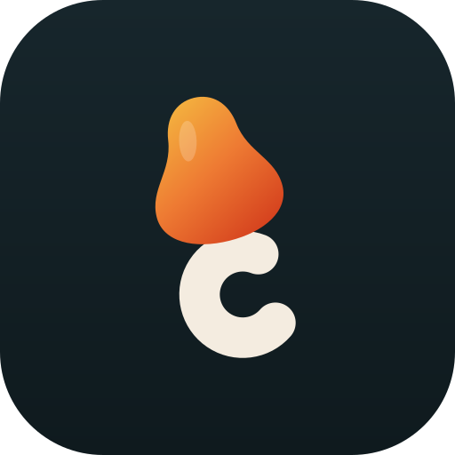
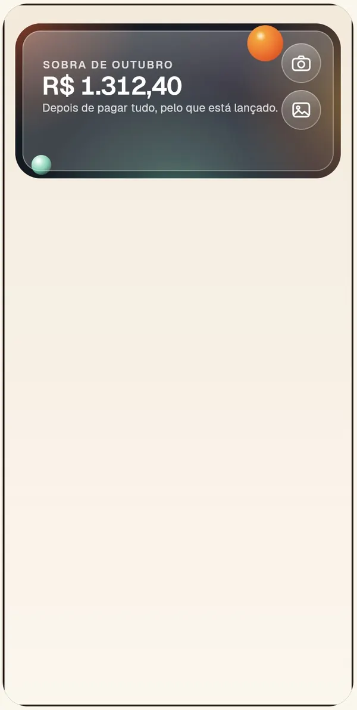
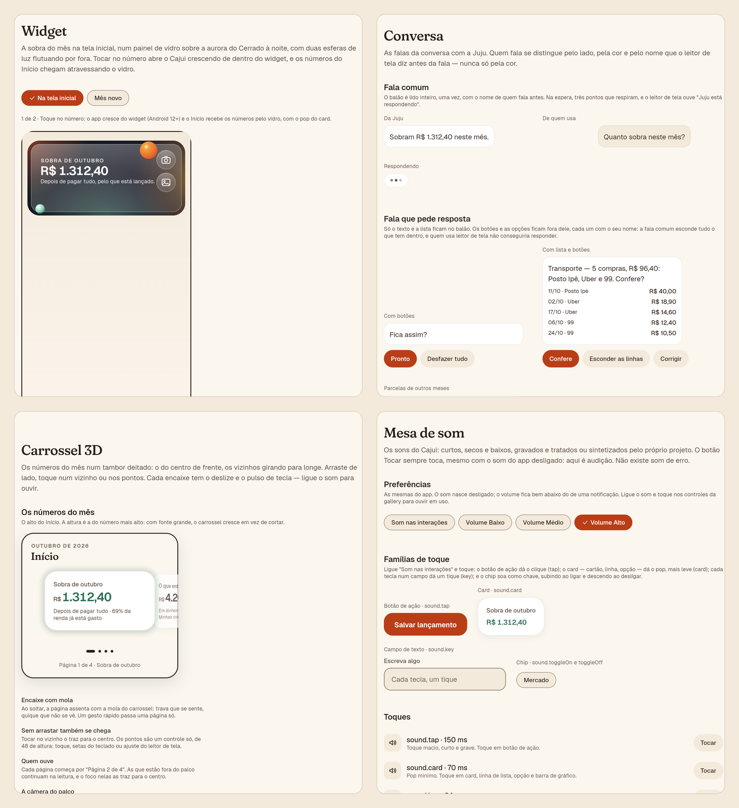

<div align="center">

<sub>**Português** · [English](README.en.md)</sub>



# Cajui · Design system

**A fonte única de tudo o que o Cajui desenha, toca e move.**

Tokens, componentes, movimento 3D, som e acessibilidade num pacote Flutter próprio, com uma gallery navegável que
mostra cada componente, cada estado de tela e cada decisão. O app não escreve uma cor, um estilo de texto ou uma
duração à mão: pede ao design system, e a esteira reprova quem tentar.

<picture>
  <source media="(prefers-reduced-motion: reduce)" srcset="../../docs/media/design-system/widget.png" />
  
</picture>

<sub>A chegada pelo widget, gravada na gallery: o app cresce de dentro do vidro e os números atravessam o véu.</sub>

**[Ver a gallery ao vivo](https://cajui-teal.vercel.app/gallery/)** · [README do projeto](../../README.md) ·
[Marca](../../docs/brand) · [Tokens](../../docs/design/tokens.md) · [Componentes](../../docs/design/components.md)

</div>

---

**Para quem avalia:** [Em 30 segundos](#em-30-segundos) · [Visual](#visual) · [O que tem dentro](#o-que-tem-dentro) ·
[Decisões que valem contar](#decisões-que-valem-contar) · [Qualidade](#qualidade)<br />
**Para quem desenvolve:** [Usando](#usando) · [Rodando a gallery](#rodando-a-gallery) · [Estrutura](#estrutura)

## Em 30 segundos

- **Fonte única:** trocar a cor de todos os botões principais do app é mudar um token. Um verificador próprio
  reprova `Color(`, `TextStyle(` e Material dentro do app.
- **Feito para um app de dinheiro:** valor com algarismos tabulares que alinham em coluna, falta do mês em barro e
  nunca em vermelho de alarme, e dinheiro e vale-alimentação sempre separados, até na cor.
- **Movimento com intenção:**
  - rolagem em profundidade e carrossel 3D;
  - entrada cinematográfica, pilha de carteira e câmera entre telas;
  - a chegada pelo widget, em que o número atravessa o vidro.

  Tudo em três níveis (`full`, `lite`, `reduced`), com o reduzido sempre respeitado.
- **Som como token:** cada família de controle tem o seu som, masterizado para o alto-falante do celular. O som nasce
  desligado.
- **Acessível por teste:** cada par de cor em uso tem o contraste da WCAG medido nos dois temas, cada controle tem área
  de toque mínima e nome para o leitor de tela, e o foco do teclado aparece num anel próprio.
- **Uma gallery que é produto:** uma porta de entrada, as 7 telas do app nos 69 estados lado a lado ([Estados das telas](https://cajui-teal.vercel.app/gallery/#/estados-das-telas)), as regras em pares ([Faça e evite](https://cajui-teal.vercel.app/gallery/#/faca-e-evite)), tema escuro, som e um endereço para cada página.

## Visual

<p align="center">
  
  <br /><sub>A gallery: o widget de vidro, a conversa, o carrossel 3D e a mesa de som.</sub>
</p>

## O que tem dentro

| Camada | O que é |
| --- | --- |
| **Tokens** | Paleta crua (não exportada) e papéis semânticos: superfície, texto, ação, borda, intenção, dados e marca. Espaço, raio, sombra, profundidade, duração, curva e mola |
| **Tipografia** | Fraunces para a voz (títulos e o número-manchete) e Geist para os dados, com algarismos tabulares |
| **Componentes** | Botão, chip, chave, campos, cartão, linha de lista, medidor, valor que rola, fala da conversa, aviso, esqueleto, gráfico mês a mês, cartão de crédito 3D, carteira, carrossel, tela-base e o vidro (aurora, painel e esfera) |
| **Movimento** | Entrada cinematográfica, câmera entre telas, rolagem em profundidade, número que conta e voa, inclinação, a chegada pelo vidro e o monitor que baixa o nível quando o aparelho perde quadros |
| **Som** | Tokens por significado (`tap`, `card`, `key`, `saved`, `notice`…), três famílias que ligam separadas e uma variação de até 3% na velocidade, para o mesmo som não soar igual duas vezes seguidas |
| **Ícones** | Desenhados em código, no mesmo traço de 1,75 com pontas redondas |

## Decisões que valem contar

### O vidro que não desfoca nada

O widget da tela inicial é de vidro sobre uma aurora, mas o Android não deixa um widget desfocar o papel de parede. Em
vez de fingir, o design system desenha como o aparelho desenha: a aurora (`CajuiAurora`) é toda luz difusa, sem
borda, e o vidro (`CajuiGlassPanel`) é só um véu translúcido com borda de luz. Ele parece fosco porque o que está atrás
já não tem contorno. A réplica da gallery e o `home_widget.xml` do app usam os mesmos valores.

### Som que se ouve no celular

Os sons de toque vieram de gravações escolhidas pelo dono, e no aparelho quase sumiam. O alto-falante de um celular
quase não toca abaixo de 300–400 Hz, e o clique do botão tinha 99% da energia entre 150 e 300 Hz. O
[`level_sounds.py`](../../tool/sound/level_sounds.py) masteriza cada arquivo para o alto-falante:

1. gera harmônicos dos graves, e o ouvido reconstrói a nota;
2. corta o subgrave;
3. satura de leve até o alvo da família, medido como o celular ouve (ponderação K da ITU-R BS.1770, sem nada abaixo de
   400 Hz).

Quando a saturação deixou o clique áspero, o botão ganhou outra gravação, mais macia, e o alvo dele subiu com menos
saturação. Um teste reprova o som que voltar a sumir.

### Falta sem alarme

A falta do mês aparece em barro, e não em vermelho. A comparação lado a lado está na própria gallery (página
[Cor da falta](https://cajui-teal.vercel.app/gallery/#/cor-da-falta)), e o vermelho ficou reservado para o que é erro de verdade.

### Movimento que se mede

Cada efeito declara o que faz em cada nível: no `lite` saem o sombreador e o desfoque, e a paralaxe fica simples; no
`reduced` as transições viram uma fusão de 120 ms e o número aparece parado, já no valor final. Um monitor de quadros
rebaixa o nível sozinho se o aparelho não acompanhar.

## Qualidade

| Item | Situação |
| --- | --- |
| Testes | **213** no pacote e **35** na gallery, incluindo contraste de cada par nos dois temas e o nível de cada som |
| Cobertura | 87,7% de linhas, com piso de 75% na esteira |
| Analisador | `very_good_analysis`, zero aviso |
| Limites | 300 linhas por arquivo, 30 por função, um tipo público por arquivo, conferidos a cada commit |
| Origem | Cada arquivo empacotado (som, fonte) tem a origem e a licença em [`assets/CREDITS.md`](assets/CREDITS.md) |

---

## Usando

```dart
import 'package:design_system/design_system.dart';

CajuiTheme(
  data: CajuiThemeData.light(),
  child: CajuiFeedbackScope(
    feedback: const SilentFeedback(),
    child: CajuiButton(label: 'Lançar', onPressed: () {}),
  ),
);
```

Cores, texto e medidas vêm sempre de `CajuiTheme.of(context)` e dos tokens (`CajuiSpacing`, `CajuiRadius`,
`CajuiDurations`…). Os componentes não tocam som: avisam o `CajuiFeedback` do que aconteceu, e quem monta o app decide
se há som, vibração ou nada.

## Rodando a gallery

```bash
cd packages/design_system/gallery
flutter run -d chrome
```

Ou o build de produção, como a Vercel faz: `bash scripts/web.sh`, da raiz, compila o app e a gallery em
`app/build/web/gallery`.

## Estrutura

<details>
<summary><b>Árvore de pastas</b></summary>

```text
lib/src/
  tokens/          paleta crua e papéis semânticos, espaço, raio, sombra, tempo, curva, mola
  typography/      a escala tipográfica
  theme/           CajuiTheme e os dois temas
  components/      cada componente numa pasta (o vidro em glass/)
  motion/          entrada, câmera, profundidade, contagem, chegada pelo vidro, níveis
  interaction/     o toque, o anel de foco e a família de som de cada controle
  feedback/        o contrato de som e vibração
  sound/           tokens de som, preferências e o tocador
  icons/           os ícones desenhados em código
  illustrations/   o cajuí da abertura, pintado em código
  accessibility/   o cálculo de contraste da WCAG e a auditoria dos pares
  format/          o valor em reais, escrito sempre do mesmo jeito
  app/             a superfície do app, as rotas e os textos do Flutter em português
assets/            fontes e sons, com a origem em CREDITS.md
gallery/           o sample navegável
```

</details>

<div align="center">

<sub>Parte do <a href="../../README.md">Cajui</a> · feito por <a href="https://github.com/Marcos-Codfy">Marcos Vinicius
Muniz Arruda</a> · Palmas-TO · 2026</sub>

</div>
